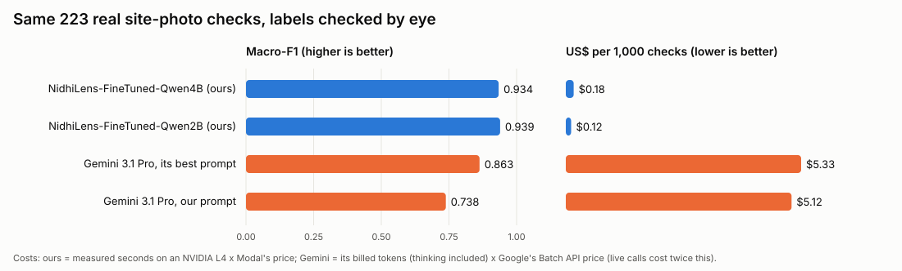
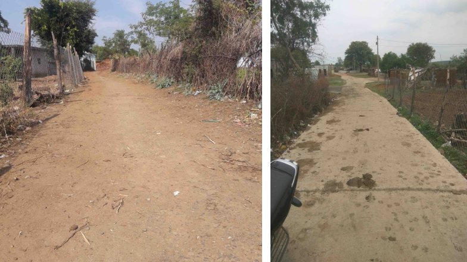
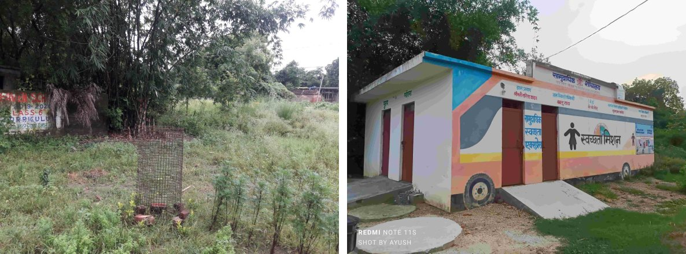
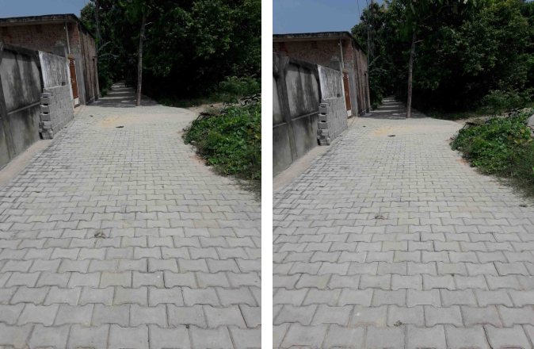
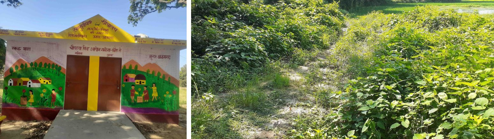
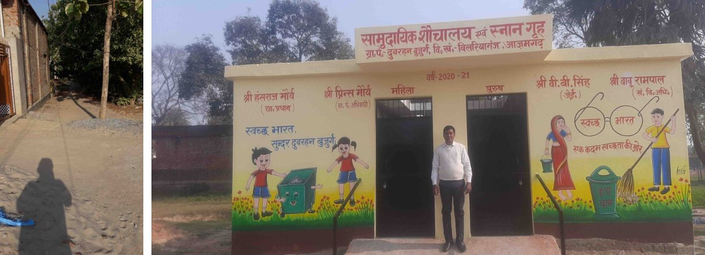
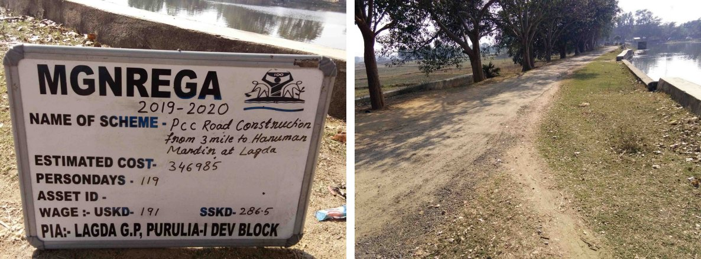
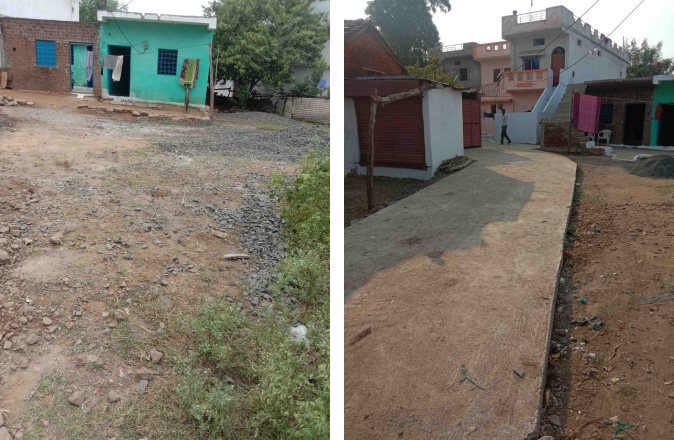
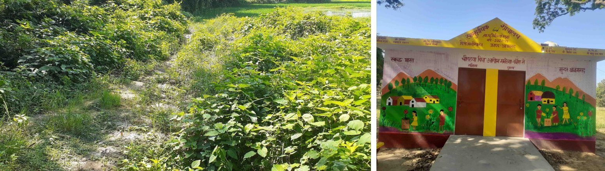

# NidhiLens-FineTuned-Qwen4B: checking construction-progress claims from site photos

**Progress report, 8 October 2026.** Team NeuralNexus, NidhiNetra (SIH 2026, problem SIH26102, MoSPI).

> **The model itself is in a private repository**
> ([AdityaMore776/NidhiLens-FineTuned-Qwen4B](https://github.com/AdityaMore776/NidhiLens-FineTuned-Qwen4B), weights in its release `v1.0`). We do not want others to
> have access to the trained weights. This report, the test data and every model output are shared here so the results
> can be checked. The weights are not.

**What it does.** An implementing agency claims progress on a public work, for example "CC road completed since the last
visit". The model looks at the site photo from the last visit (A) and the one from this visit (B), and answers in JSON:

| Answer | Meaning |
|---|---|
| `shown` | The photos support the claim |
| `not_shown` | The photos go against it: nothing permanent was added, or the work was already there and is claimed again |
| `cant_tell` | The photos cannot decide (another place, too dark, view blocked) |

It is a 4-billion-parameter open model (Qwen3-VL-4B-Instruct) with a small trained add-on (LoRA, 33 M weights). It runs
on one mid-range GPU. **It was trained in 59 minutes on one NVIDIA A100 40 GB GPU, rented by the second from
[Modal](https://modal.com) (a serverless GPU cloud), for about US$2** (§5.4).

---

## 1. The benchmark against Gemini 3.1 Pro



### 1.1 Gemini at its best: the whole clean test (883 real checks)

Gemini 3.1 Pro answered all 883 clean test checks with its best prompt: our prompt plus the task's rules, written out
for it.

| Judge | Macro-F1 [95% CI] | Accuracy | Work called "shown" though nothing was built (of 576) | Real finished work missed (of 121) | US$ per 1,000 checks |
|---|---|---|---|---|---|
| **NidhiLens-FineTuned-Qwen4B** | **0.935** [0.920, 0.951] | **96.0%** | 4 | 21 | **0.17** |
| NidhiLens-FineTuned-Qwen2B | 0.927 [0.907, 0.946] | 95.1% | 15 | 14 | 0.12 |
| Gemini 3.1 Pro, its best prompt | 0.876 [0.843, 0.909] | 91.3% | **2** | 31 | 5.27 |
| Gemini 3.1 Pro, the same prompt as ours | 0.711 [0.667, 0.760] | 84.6% | 2 | 87 | 5.15 |
| Qwen3-VL-4B, before our training | 0.493 [0.452, 0.534] | 45.0% | 7 | 61 | 0.83 |
| Qwen3-VL-2B, before our training | 0.467 [0.431, 0.502] | 67.0% | 56 | 40 | 1.03 |

McNemar against Gemini at its best (same 883 checks):
- **our 4B:** right on 57 checks Gemini gets wrong, wrong on 15 (p = 7×10⁻⁷);
- **our 2B:** 55 against 21 (p = 1×10⁻⁴).

The difference is not chance.

### 1.3 The hardest trick: another finished work of the same kind (93 checks)

Photo B is a finished road (or building) from **another** place in the same district. An agency could try exactly this.

| Judge | Correct "can't tell" |
|---|---|
| Gemini 3.1 Pro, our prompt | **93 of 93** |
| **NidhiLens-FineTuned-Qwen4B** | 86 of 93 |
| Gemini 3.1 Pro, its best prompt | 82 of 93 |
| NidhiLens-FineTuned-Qwen2B | 74 of 93 |
| Qwen3-VL-4B, before our training | 62 of 93 |

### 1.4 What it costs

| | US$ per 1,000 checks | Per 10 lakh checks | Times cheaper than Gemini |
|---|---|---|---|
| **NidhiLens-FineTuned-Qwen4B** (NVIDIA L4) | **0.17** | **$173** | n/a |
| NidhiLens-FineTuned-Qwen2B (NVIDIA L4) | 0.12 | $117 | n/a |
| Gemini 3.1 Pro, Batch API (half price, answers within 24 h) | 5.15 | $5,148 | **30×** (4B), 44× (2B) |
| Gemini 3.1 Pro, normal calls | about 10.3 | about $10,300 | **60×** (4B), 88× (2B) |

How each cost was measured:
- **Ours:** the measured seconds a check (0.78 s for the 4B and 0.53 s for the 2B, answering 8 checks at a time) × Modal's published L4 price
  ($0.000222 a second).
- **Gemini:** the tokens Google billed for each answer, thinking included (about 2,400 in and 470 out), × Google's
  published price for Gemini 3.1 Pro ($2 / $12 per million tokens; half that through the Batch API). Prices were read on
  8 October 2026.
- **Ours, on a team member's own PC:** about electricity only, and the model works offline.

### 1.5 What this shows, honestly

- **More accurate than Google's top model on this task, at a thirtieth of the bulk price.**
  - It holds on Gemini's best prompt (0.935 against 0.876, all 883 checks) and on fresh sites (§1.2).
  - The gap is in confirming real work. Gemini misses a quarter (best prompt) to three-quarters of real, finished works, mostly
    answering "can't tell" because the two photos were taken from different spots. As a checker, that would send
    most honest agencies to an inspection.
- **Gemini is fooled less often.**
  - Fooled: 2 of 576 against our 4 (4B).
  - Probe: it passes 93 of 93 with our prompt, but that setting misses 69–72% of real work. With its best prompt it
    passes 82, below ours.
  - No Gemini setting we tried does both.
- **The small 2B model is level with the 4B on the test** (McNemar p = 0.26) and is cheaper again. It is weaker on the
  same-type trick: 74 of 93.

---

## 2. The test data (download it yourself)

**Everything is real.** Each check is a pair of real, unedited site photos:
- **850 checks** from GeoMGNREGA: the before / during / after photos that Indian MGNREGA works publish on ISRO's
  public Bhuvan portal. They come from 203 works in 5 held-out districts;
- **33 checks** from real construction timelapses (10 YouTube videos, CC BY licence).

**Nothing is drawn, rendered, pasted or edited** in any test photo.

**No model saw the test before.** The test districts are chosen by a fixed hash of the district code, and the training
never used them. Checked over all 976 test and probe checks:
- districts shared with training: **0**;
- sites shared with training: **0**;
- identical photo files shared with training (by file hash): **0**.

**Every label was checked by eye, three times:**
1. contact sheets, ten checks a sheet;
2. "asset cards": all six stage photos of a work in one row, so a before photo that already shows the finished work
   is caught;
3. a large re-check of every site where any judge (ours, or Gemini) disagreed with the label.

The checks found and fixed whole kinds of wrong labels:
- rooftop rainwater pits counted as buildings;
- timelapse frames from shaky or cut camera shots;
- "work added" timelapse labels that were really snow, seasons or advert cards.

They also removed individual wrong ones. 32 were dropped in the last round, and **a fix to one photo is applied to
every check that uses it, not only to the disputed ones**, so the cleaning cannot favour either side.

**Download:** the GitHub release [**`siteclaim-test-v1`**](https://github.com/AdityaMore776/NidhiNetra/releases/tag/siteclaim-test-v1)
of this repository holds `siteclaim_test_v1.zip` (364 MB). Or run
`gh release download siteclaim-test-v1 --repo AdityaMore776/NidhiNetra`. Inside:

| Path | What |
|---|---|
| `images/` | All 1,053 photos, exactly as the judges saw them (Gemini got them at full size, ours at 512 px) |
| `items_test.jsonl`, `items_probe.jsonl` | Each check: the two photo paths, the claim, the eye-checked label, how the check was made |
| `predictions/` | **Every answer of every judge**, word for word, with timings and billed tokens |
| `PROMPTS.md` | The exact prompts |
| `ATTRIBUTION.md` | Where every photo comes from, with the licence of each video |

The same items and predictions, without the photos, are in [`data/`](data/).

---

## 3. Real examples: the photos, the claim, the answers

Below are real checks from the test, chosen to show wins, losses and ties, not only wins. Photo A is on the left and
photo B on the right. The outputs are copied word for word from `predictions/`.

### Example 1: a real new road. Ours right; Gemini (best prompt) says it cannot tell


Claim (Hinglish, "road completed since the last visit"): *"Pichhli visit ke baad sadak poora"*. Label: **shown**
(GeoMGNREGA asset mg-122730496; the same fence and trees are in both photos).

- **Ours:** `{"same_place": "yes", "stage_A": "not started", "stage_B": "complete", "permanent_change": "yes", "verdict": "shown", "reason": "Photo A shows an unpaved earth track; photo B shows a finished paved road, which matches the claim."}`
- **Gemini 3.1 Pro (best prompt):** `{"same_place": "unsure", ..., "verdict": "cant_tell", "reason": "The photos show fences on opposite sides and different backgrounds, making it impossible to confirm they are the same location."}`
- **Gemini 3.1 Pro (our prompt):** `shown`, "Photo B, taken from the opposite direction, shows a completed concrete road".

### Example 2: a real new toilet block. Both right (Gemini with our prompt: can't tell)


Claim: *"School toilet block completed since the last visit"*. Label: **shown** (mg-180395112).

- **Ours:** `shown`, "Photo A shows an open plot with no building; photo B shows a finished building, which matches the claim."
- **Gemini (best prompt):** `shown`, "Photo A shows an empty site, while Photo B shows a fully constructed and painted toilet block".
- **Gemini (our prompt):** `cant_tell`, "The photos show completely different locations with no matching landmarks".

### Example 3: the road was already there. Both right


Claim: *"Interlocking tile road completed since the last visit"*, on two photos of the same moment. Label: **not_shown**.

- **Ours:** `not_shown`, "The work was already complete in photo A, so it was not done in this period."
- **Gemini (both prompts):** `not_shown`, "The interlocking tile road is already complete in photo A, so no new permanent work was done between the visits."

### Example 4: the photos in the wrong order. Ours right, Gemini can't tell


Claim: *"Community sanitary complex completed since the last visit"*. Photo B is the **earlier** photo (empty ground).
Label: **not_shown**.

- **Ours:** `not_shown`, "Photo B shows an open plot with no building, less built than photo A; this is not progress."
- **Gemini (both prompts):** `cant_tell`, "The photos show completely different locations".

### Example 5: another place altogether. Both right


Claim (Hindi): *"पिछली विज़िट के बाद सड़क पूर्ण"* (road completed since the last visit). Photo B is a toilet block
elsewhere. Label: **cant_tell**.

- **Ours:** `cant_tell`, "Photos A and B show different places, so the claim cannot be judged from them."
- **Gemini (both prompts):** `cant_tell`.

### Example 6: ours is fooled, Gemini is right


Claim: *"CC road completed"*. Photo A is the work's signboard; photo B, taken at the same moment, is still an earth
track. Label: **not_shown**.

- **Ours:** `shown`, "Photo A shows an unpaved earth track; photo B shows a finished paved road". **Wrong**, and it
  describes photo A wrongly. This is one of the 4 times in 576 that our 4B was fooled.
- **Gemini (both prompts):** `not_shown`, "Photo B shows an unpaved dirt road, contradicting the claim".

### Example 7: a real new road from a new angle. Gemini (best prompt) right, ours can't tell


Claim: *"CC road completed since the last visit"*. Label: **shown** (mg-131763742; the teal house is in both photos).

- **Ours:** `cant_tell`, "Photos A and B show different places". **Wrong.**
- **Gemini (best prompt):** `shown`, "Photo A shows an unpaved surface, while Photo B shows a newly constructed concrete road".

### Example 8: both fail


Claim: *"Pichhli visit ke baad bhawan poora"* (building completed since the last visit). Label: **shown**. The before
photo shows only vegetation, so nothing ties the two photos to one spot.

- **Ours:** `cant_tell`. **Gemini (both prompts):** `cant_tell`, "no common landmarks". Neither confirms the work. A GPS
  tag check, which NidhiNetra does separately, is the answer here.

---

## 4. Exactly what both models were asked

Both get the two photos, labelled **"Photo A (last visit):"** and **"Photo B (this visit):"**, then the question.

**System text (all judges):**
> You check site photos of an Indian public work against the implementing agency's claim. Photo A is from the last
> visit and photo B from this visit, at the same spot. Judge only what is visible. Workers, vehicles, animals, stacked
> materials, light and shadows are not progress; only permanent structure added counts. Say cant_tell when the photos
> cannot decide (different place, too dark, view blocked). Never accuse anyone.

**The question** (example):
```
Work type: road. Stages: not started -> work under way -> complete.
Agency's claim (work done between A and B): "CC road completed since the last visit"
Reply with JSON only: {"same_place": yes|no|unsure, "stage_A": <stage or unknown>, "stage_B": <stage or unknown>,
"permanent_change": yes|no|cant_tell, "verdict": shown|not_shown|cant_tell, "reason": <at most 25 words>}
```

**Gemini's best prompt** adds the task's rules to the system text. They say:
- how the two kinds of claim differ;
- that photos of one work are often taken from different spots;
- that people, vehicles, light and seasons are never progress.

The rules are given in full in [`data/PROMPTS.md`](data/PROMPTS.md). They contain no example and nothing from the test.
They were written after reading why Gemini failed, which favours Gemini, not us.

**Fairness:**
- **Each model at its best:**
  - Gemini got the photos at full resolution, its own thinking, temperature 0, and the choice of 4 worked examples
    (from training districts only).
  - The examples made it worse on calibration (0.68 against 0.73) and cost 3× more, so they were not used.
  - Our model was also tried at 1,024 px: it was no better (0.935 against 0.935), so it runs at 512 px.
- **Settings were chosen on a separate calibration split, never on the test.**

---

## 5. How it was built

### 5.1 Architecture

```
photo A ─┐                                       ┌─ same_place
         ├─> Qwen3-VL vision encoder (frozen) ──>│
photo B ─┘   (each photo ≤ 512 px, ≤ 256 tokens)  │   Qwen3-VL language model
claim ─────> text tokens ───────────────────────>│   + LoRA (rank 16, α 32) on every
                                                  │   attention and MLP projection   ──> JSON answer
                                                  └─ (q, k, v, o, gate, up, down)        (≤ 100 tokens)
```

**The model:**
- **Base:** Qwen3-VL-4B-Instruct (open weights). The vision encoder is frozen. LoRA adapters (33.0 M trainable
  weights; 17.4 M for the 2B) sit on the language model's linear layers. The 2B was trained before the edited-photo
  decision, so its training data includes them (3,655 checks).
- **Output:** short JSON. The verdict's probability is read from the model's own next-token scores, so it can be
  calibrated: expected calibration error 0.03 on the test.
- **Training:**
  - 2 passes over 2,924 real training checks, learning rate 1e-4 with cosine decay, batch of 8 (accumulated);
  - loss only on the answer's tokens;
  - each photo randomly cropped, turned and re-saved on its own, as a hand-held phone would;
  - 59 minutes on one NVIDIA A100 40 GB (Modal), about **$2.05**. The 2B: 38 minutes, about $1.31.

### 5.2 The data: the "Hindsight Claim Ladder"

1. **Collect real stage photos.** 717 MGNREGA works from 36 districts in 20 states went into this dataset (the
   harvest has since grown to 1,237), at one request every 1.5 s: roads, toilets, Anganwadis, Panchayat buildings,
   walls and drains. Training used 29 districts.
2. **Only certain progress counts as progress.** A before → after pair is labelled "shown" only if:
   - the work is an unmistakable structure (a road, building, wall or drain; never earthwork, ponds or repairs);
   - the photos changed more than the site's own same-moment photos do (DINOv2 features);
   - and the change passed a minimum set by eye.
3. **One pair, many claims.** Each pair yields several claims with exact answers:
   - "completed" against "started";
   - "since the last visit" against "as of now";
   - the photos swapped;
   - the same finished work claimed twice;
   - two photos of one busy moment;
   - another place, of another type **and of the same type**;
   - in English, Hinglish and Hindi.
4. **Held-out test.** Whole districts, then the eye checks described in §2.

### 5.3 What we tried and dropped (each measured)

| Tried | Result | Decision |
|---|---|---|
| "Different place" pairs of another work type only | The model learnt "different type = different place". It was fooled by another finished road 38 times in 44 | Added same-type other-place pairs: now 86 of 93 |
| Edited training photos (people pasted in, light, dark) | No better than real photos only (McNemar p = 0.84). Fooled more (11 against 5) | **Dropped**; real photos only |
| Reinforcement learning (GRPO) on the model's own mistakes | It became a yes-sayer: fooled 48 of 580 (earlier test), the probe 10 of 93 | Rejected |
| GRPO again, with practice balanced across the three answers | Calibration: macro-F1 0.893 against 0.870, but fooled 6 of 87 against 1; the probe 48 of 93 against 86 | Rejected, judged without touching the test |
| 1,024 px photos | 0.935 against 0.935, at 2.2× the cost | Kept 512 px |
| Timelapse "work added" labels from a change detector | Only 1 of 41 was real progress, by eye (snow, seasons, adverts) | Only eye-confirmed timelapse labels kept |
| Answering one check at a time | 7.5 s a check, GPU 39% busy | 8 at a time with the add-on merged: under 1 s, identical answers |

---

### 5.4 Training compute: NVIDIA A100 on Modal

All training and scoring ran on [Modal](https://modal.com), a serverless GPU cloud: a GPU is rented by the second
while a job runs, then released. It was paid from the team's Modal credit. The team's own PC (an NVIDIA RTX 3070 Ti,
8 GB) built the data: DINOv2 change features, person and vehicle cut-outs, and the photo harvest.

| Job | GPU (on Modal) | Time | Peak GPU memory | Cost |
|---|---|---|---|---|
| **Fine-tuning NidhiLens-FineTuned-Qwen4B** (2 passes over 2,924 real checks, 731 optimiser steps) | **NVIDIA A100 40 GB** | **58.6 minutes** | 15.7 GB | **about US$2.05** |
| Fine-tuning NidhiLens-FineTuned-Qwen2B (2 passes over 3,655 checks, 914 steps) | NVIDIA A100 40 GB | 37.5 minutes | 8.5 GB | about US$1.31 |
| Scoring a model on the test (883 checks, 8 at a time) | NVIDIA L4 24 GB | about 11 minutes | 10.5 GB | about US$0.15 |
| Calling Gemini (Batch API), with the key held in a Modal Secret | CPU only | n/a | n/a | Google's bill (§1.4) |

How the costs were worked out:
- training time and memory are from each run's own log (`train_info.json`);
- each cost is the time × Modal's published price ($0.000583 a second for an A100 40 GB, $0.000222 for an L4).

**The whole project used US$23.32 of Modal time** (Modal's billing report, 8 October 2026). That figure includes:
- every experiment that was rejected (the first dataset versions, both reinforcement-learning runs, the edited-photo
  ablation);
- the slow first scoring runs, before answers were batched.

## 6. Limitations

- **The government photos in the main test come from 5 districts** (203 works), plus 33 timelapse checks. More held-out
  districts are the next step.
- **The labels were checked by an AI agent's eye.** Checking by people is the next step.
- **Being fooled is rare but not zero:** 4 of 576 for the 4B. Example 6 shows a case, where the model also
  misdescribed photo A.
- **Some choices were informed by the test.** The edited-photo ablation and the first GRPO run were judged on it. The
  label re-check was triggered by disagreements on it, and was applied to every check of each site, to both sides.
- **Same-type tricks need the GPS check too.** Photos alone cannot tie a close-up of a finished building to an empty
  plot.

## 7. Reproduce

The code is in `apps/vision/` (the vision package and `modal/train_modal.py`). Until pull requests #120 and #121
are merged it lives on the branch
[`adityamore776/T150-vlm-progress-dataset`](https://github.com/AdityaMore776/NidhiNetra/tree/adityamore776/T150-vlm-progress-dataset/apps/vision).

| Step | Command |
|---|---|
| Data | the `vlmbuild` command of the vision package (`apps/vision`) |
| Train | `modal run modal/train_modal.py::sft --items ... --real-only` |
| Score | `modal run modal/train_modal.py::score_l4 --adapter ...` |
| Gemini | `modal run modal/train_modal.py::flagship_round ...`: a hard spending ledger prices every call before it is sent |
| Compare | `python data/trial/vlm_compare.py --runs ... --split test --keep items_eye3.jsonl` |

The raw results are in `data/trial/results/vlm_compare_*.txt`, and the full history is in `docs/trial/FINDINGS.md`
(T151–T155).
