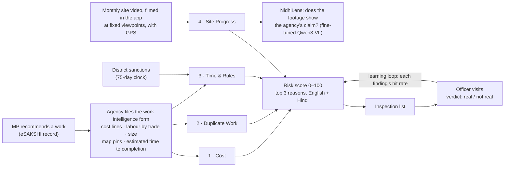

# NidhiNetra: the AI eye on every MPLADS rupee

**Smart India Hackathon 2026 · Problem Statement SIH26102 · Ministry of Statistics & Programme Implementation (MoSPI)**
**Team NeuralNexus (Team ID 121911)**

> *Development of an AI-powered system to detect anomalies, fraud, and inefficiencies in MPLAD Scheme implementation.*

NidhiNetra is a risk-intelligence layer on top of **eSAKSHI**, the government portal that runs the MPLAD Scheme. Four
specialist agents check every work, at the moments that matter, against something that can prove a claim. The works an
officer should inspect go into one ranked list, each with the reason, in plain English and Hindi.

**Live prototype (open, no sign-in):** https://nidhinetra-sih.vercel.app

> **New: NidhiLens, our own fine-tuned vision model for site progress.** On 883 real site-photo checks it is more
> accurate than Google's Gemini 3.1 Pro (macro-F1 **0.935 against 0.876**, McNemar p = 7×10⁻⁷) at **1/30 of the cost**.
> The full report, with the real photos, both models' answers and downloadable test data, is in the folder
> **[`NidhiLens (Fine-Tuned Qwen for site progress monitoring)`](NidhiLens%20(Fine-Tuned%20Qwen%20for%20site%20progress%20monitoring)/README.md)**.

---

## In one minute

- **The scale.** Every Member of Parliament gets **₹5 crore a year** to recommend local works: roads, lights, hand
  pumps, halls. About **2.1 lakh works** are on eSAKSHI.
- **The gap.** A district cannot inspect them all, and auditors (CAG) keep finding the same problems: inflated
  estimates, one asset funded twice, one job split to dodge a limit, works "finished" impossibly fast, progress that was
  never built.
- **NidhiNetra checks every work.**
  - It checks at the source: the agency's own estimate form, its map pins, and the site itself on video.
  - Four agents each answer one question.
  - Their answers become one **0–100 risk score** with the **top three reasons**, and an **inspection list** for the
    district officer.
- **It never accuses anyone.** It says "needs checking", shows the facts behind it, and an officer decides. "Couldn't
  check" is a status, never a clean chit.

## The architecture



| # | Agent | The one question | It takes its certainty from | It asks an officer to check when… |
|---|---|---|---|---|
| 1 | **Cost** | Is every line of the estimate fairly priced for this district, and is the whole estimate fair? | The state's Schedule of Rates, and what other agencies in the district recently paid (never the agency's own); quantities held to what the size needs; labour judged trade by trade | The whole estimate is 15%+ **and** ₹50,000+ above its fair price, or one trade's day rate is twice what others pay it |
| 2 | **Duplicate Work** | Is this work already sanctioned here, or one job cut into pieces under a limit? | The form's map pins against sanctioned works of the same kind; the agency's own signed answers | A sanctioned work of the same kind within 50 m, a declared rebuild under 3 years old, or every piece of a group 96–100% of a limit |
| 3 | **Time & Rules** | Was it sanctioned on time, and is it being finished in a believable time? | The record's dates, and a "comfort window" from the agency's own estimated time to completion | It is finished faster than it can be built and no site video shows it being built, or it runs well past its own promised time. A late sanction alone is an office fact, never a flag |
| 4 | **Site Progress** | Do the monthly site videos show real, new work, at this site, for this work only? | Sealed in-app videos at the same viewpoints with GPS; reused-footage fingerprints; **NidhiLens** reads whether the footage shows the claimed progress | Footage used before, filmed somewhere else, another work's site, or the claimed stage not shown two visits running |

**Why only four.** Each one has a certain source of truth, so it can ask only about what is likely fraud, never a typing
mistake. Earlier checks are retired, and their measured results stay in [`docs/trial/FINDINGS.md`](docs/trial/FINDINGS.md):
Guideline Compliance (its timing rules live on in Time & Rules), Fund Flow, Office Patterns, Paperwork and Photo
Evidence. Plan in plain words: [`docs/plans/T120-four-agents.md`](docs/plans/T120-four-agents.md).

**One AI model, where nothing simpler works.** Arithmetic and maps decide Cost, Duplicate Work and Time & Rules. Only
Site Progress needs to *see*: does this month's footage show the claim? For that the team fine-tuned **NidhiLens**, an
open 4-billion-parameter vision model:
- trained on real Indian government stage photos;
- tested on held-out districts, against Gemini 3.1 Pro.

NidhiLens is benchmarked and published as a report. It is not yet switched on in the live engine.

## What works today

| | State |
|---|---|
| **Live web app** (https://nidhinetra-sih.vercel.app) | Open to everyone. **Work intelligence form** (`/work-form`): 13 real-style filings graded by the four agents, with every asked-about field outlined, and "check this form" on any filing. **Form to risk score** (`/end-to-end`): five filings through the real engine. **Step by step** (`/explain`): one work through every step. Staff sign-in adds the dashboard, India map, review queue, works search and work pages on the real data. |
| **Real data** | All **2,09,993** real eSAKSHI works loaded and assessed. On eSAKSHI's public dashboard table (40,935 works), the review queue is **217** works. |
| **The four agents** | Built and tested: **883 engine tests**; a robustness loop of 112 attack probes, 0 failing. Duplicate Work was re-fitted on real villages (Jaunpur, then tested in six more districts): honest street lights asked 0–1.5%, repeats still caught 86–98%. Cost judges labour trade by trade (honest filings 0 of 450 asked; one trade at 2.5× caught 88%). Numbers: [`docs/trial/FINDINGS.md`](docs/trial/FINDINGS.md) (T121–T142). |
| **Site Progress** | The capture app (sealed video, fixed viewpoints, GPS) and its video checks are built. The trial on real sites is next (T126). **NidhiLens** (the claim judge) is trained and benchmarked; [report](NidhiLens%20(Fine-Tuned%20Qwen%20for%20site%20progress%20monitoring)/README.md). |
| **Real-evidence trial** | Every early check was tried on real evidence for **837 completed works**: 905 files from eSAKSHI's public endpoints, 1,925 pages read. |

**NidhiLens against Gemini 3.1 Pro.** Same 883 real site-photo checks, every label checked by eye:

| | Macro-F1 | Real finished work missed | Fooled (no work, called "shown") | US$ per 1,000 checks |
|---|---|---|---|---|
| **NidhiLens-FineTuned-Qwen4B** | **0.935** | 21 of 121 | 4 of 576 | **0.17** |
| NidhiLens-FineTuned-Qwen2B | 0.927 | 14 of 121 | 15 of 576 | 0.12 |
| Gemini 3.1 Pro, its best prompt | 0.876 | 31 of 121 | 2 of 576 | 5.27 |

Gemini is fooled slightly less often on that test. On 314 fresh checks, labelled by eye before any model saw them,
NidhiLens scores 0.914 (4B) and 0.938 (2B) against Gemini's 0.830, and Gemini is fooled as often as ours. The
report shows the cases where each model fails.

---

## Read more

| If you want… | Read |
|---|---|
| **NidhiLens**: the vision model, its benchmark against Gemini, real examples, test data | [`NidhiLens (Fine-Tuned Qwen for site progress monitoring)`](NidhiLens%20(Fine-Tuned%20Qwen%20for%20site%20progress%20monitoring)/README.md) |
| **How NidhiNetra works, in plain words** (no code) | [`docs/HOW-IT-WORKS.md`](docs/HOW-IT-WORKS.md) |
| **Every agent**: what it checks, how, how it was tested, where it stands | [`docs/AGENT-CATALOG.md`](docs/AGENT-CATALOG.md) |
| **The four agents' design**, in plain words | [`docs/plans/T120-four-agents.md`](docs/plans/T120-four-agents.md) |
| **Real-data trial**, agent by agent, with every number | [`docs/trial/FINDINGS.md`](docs/trial/FINDINGS.md) |
| **Technical architecture**: components, scoring maths, API, database, security | [`docs/ARCHITECTURE.md`](docs/ARCHITECTURE.md) |
| **Data**: sources, the evidence harvester, privacy, known traps | [`docs/DATA.md`](docs/DATA.md) |
| **Run it yourself**: local setup, tests, deployment | [`docs/SETUP.md`](docs/SETUP.md) |
| **Where the build is and what's next** | [`docs/STATUS.md`](docs/STATUS.md) |
| **MPLADS and project terms** | [`docs/GLOSSARY.md`](docs/GLOSSARY.md) |
| **Joining the team?** How we work together (humans + their AI agents) | [`docs/team/README.md`](docs/team/README.md) · AI manual: [`AGENTS.md`](AGENTS.md) |
| **The task plan** and who's doing what | [`docs/team/TASKS.md`](docs/team/TASKS.md) · [Issues](https://github.com/AdityaMore776/NidhiNetra/issues) · [progress log](docs/team/log/) |
| **Team rules** for working on the repo | [`CONTRIBUTING.md`](CONTRIBUTING.md) |
| Earlier design documents (history) | [`docs/specs/`](docs/specs/) |
| The SIH idea-submission deck | [`docs/deck/DRISHTI_SIH26102_v2.pdf`](docs/deck/DRISHTI_SIH26102_v2.pdf) |

## Repository map

```
NidhiNetra/
├── NidhiLens (Fine-Tuned Qwen for site progress monitoring)/
│                        the vision model's report: benchmark vs Gemini 3.1 Pro, real examples, test data, design
├── apps/
│   ├── engine/          Python FastAPI service: the four agents, the risk score, the API  (883 tests)
│   │   └── drishti/     (the engine's package keeps its first name)
│   │       ├── agents/          cost_estimate · dup_split · time_rules · site_progress, and the agent contract
│   │       ├── fusion/          combines agent results into the 0–100 score and its top 3 reasons
│   │       ├── cost_form/       the work intelligence form: fields, materials, labour trades, checks
│   │       ├── video/           the site video job: fingerprints, view matching, change, face blurring
│   │       ├── pipeline/        runs agents → fusion for one work
│   │       ├── api/             REST endpoints used by the web app
│   │       ├── reference/       guideline clauses, rates, time bands, work types
│   │       └── migrations/      database schema (SQL)
│   └── web/             Next.js app: work form, form to risk score, step by step, dashboard, queue, capture
├── data/                offline jobs: corpus, statistics, database load, batch assessment
│   ├── harvest/         download eSAKSHI evidence politely (pilot sample)
│   └── trial/           every agent's real-data trial and its saved results
├── docs/                everything a reader needs (see the table above)
│   └── team/            the team system: task plan, progress log, data pack, how we work
├── scripts/             team tools (sync, new_log, check_pr) and local development
├── AGENTS.md            the operating manual every AI agent on the team follows
├── .github/             CI (tests, team checks, secret scan), issue and PR templates
└── vercel.json          hosting: web and engine as two services on one domain
```

## Tech stack

- **Web:** Next.js 16 (React 19), Tailwind CSS 4, MapLibre maps on official LGD boundaries.
- **Engine:** Python 3.12, FastAPI, psycopg 3.
- **Database and sign-in:** Supabase (PostgreSQL, Auth).
- **Site video:** OpenCV (fingerprints, ORB view matching, optical flow, face blurring).
- **Vision model (NidhiLens):**
  - Qwen3-VL-4B-Instruct + LoRA (PyTorch, Transformers, PEFT);
  - trained on NVIDIA A100 GPUs on Modal;
  - runs on one mid-range GPU.
- **Analysis:** pandas, scikit-learn, local OCR (RapidOCR, PyMuPDF).
- **Hosting:** Vercel, with the database in the Mumbai region.

## Principles we don't break

1. **Needs verification, never "fraud".** Accusing words are blocked in code (`BANNED_WORDS`); a test fails if any agent uses one.
2. **"Could not check" is not a clean chit.** An agent that cannot assess a work says so; it never counts as low risk.
3. **Proof before launch.** An agent goes live only after it meets its accuracy target on real data. If it fails, it stays off.
4. **Only measured numbers.** Every figure in this repo comes from a script whose output is saved in `data/trial/results/`.
5. **Privacy.** Downloaded evidence, OCR text, phone numbers and bank account numbers never enter git or the screen.

---

*Data: MPLADS eSAKSHI public dashboard (snapshot 26 May 2026), LGD boundaries, CAG Report 31 of 2010-11. NidhiLens test
photos: GeoMGNREGA stage photos on ISRO's public Bhuvan portal, and CC BY construction timelapses. This is a hackathon
prototype, not an official government system; findings are leads for an officer to check, not rulings.*
