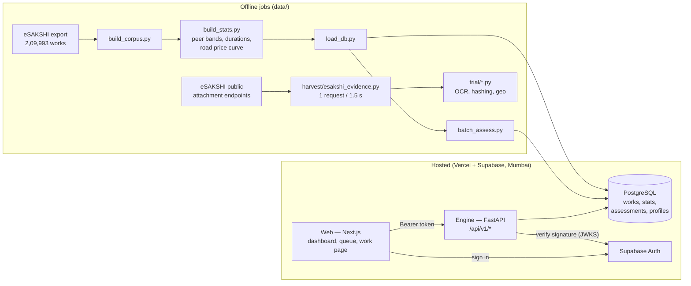

# DRISHTI — technical architecture

*The plain-language version is [HOW-IT-WORKS.md](HOW-IT-WORKS.md). The full design, with the reasoning
behind each choice, is in [`specs/`](specs/): the prototype design (architecture and stack) and the v2
design (12 agents, real evidence).*

---

## 1. The system in one picture



**One work's journey through the engine** (`pipeline/orchestrator.py`):

```
work record ─► 2 DATA VALIDATION ─► 3 AGENTS (each returns an AgentResult) ─► 4 RISK FUSION ─► score, band, parts, priority
                 validation/          agents/<agent>/                         fusion/fuse.py
```

## 2. Components

| Component | Where | What it does |
|---|---|---|
| **Engine** | `apps/engine/drishti/` | Python 3.12 + FastAPI. Validation, agents, fusion, the REST API, auth, migrations. Deployed as a Vercel Service (`drishti.main:app`). |
| **Web** | `apps/web/src/` | Next.js 16 (App Router, React 19), Tailwind 4, MapLibre 6. Pages: `/login`, `/` (dashboard + India map), `/queue`, `/works`, `/work?id=…`, `/how-it-works`. |
| **Database** | Supabase PostgreSQL | Tables below. Row-level security on; the engine connects server-side and applies scoping in every query. |
| **Auth** | Supabase Auth | Email login. The engine verifies the access token itself and reads role + district from `profiles`. |
| **Offline jobs** | `data/` | Build the corpus and statistics, load the database, assess all works, draw map outlines, harvest evidence, run the trial. |
| **CI** | `.github/workflows/ci.yml` | Engine: `ruff` + `pytest`. Web: `tsc`, `eslint`, `next build`. |
| **Hosting** | `vercel.json` | Two services on one domain: `/api/v1/*` → engine, everything else → web. Auto-deploys on push to `main`. |

### Engine layout

| Module | Purpose |
|---|---|
| `agents/contract.py` | `AgentResult` / `Finding` / `Status`; the banned-word guard; `not_built()` placeholder |
| `agents/registry.py` | finds engines by folder (`agents/<id>/engine.py`); the five blueprint slots and their weights |
| `agents/compliance/` | **Guideline Compliance**: rules R01–R14 from `reference/rules.json` (English + Hindi), eligibility v2 reader |
| `agents/statistical/` | the **Cost** engine: `scope.py` (what a description covers: goods/works, bundles, counts), `cohort.py` (peer statistics store), `text.py` (length reading), `unit_rate.py` (road ₹/m), `price_model.py` (word-price model, applied to any description, T051), `agent.py` (like-for-like peers + the price model must agree) |
| `agents/dup_split/` | **Duplicate & Split Work**: `match.py` holds the rules and compares ANY work with its district live (stdlib only; the batch builds one index of every work, the API one per district, T051) |
| `agents/delay/` | **Fund Flow** (stored id `delay`): ended-term works still unsanctioned, office sanction backlog against its district (`backlog.py`, counted live); the delay forecast was removed in T053; shown, not counted |
| `agents/office_patterns/` | **Office Patterns** (2 Oct 2026): `index.py` counts per office, live from all works, how many works are priced just under a limit (96-100% of ₹5 lakh, ₹10 lakh, ...) and how many constructions are recorded complete within 7 days of sanction; an office is "routine" only when its Wilson lower bound is at least 3× the national share (30+ priced works, 15+ built). `agent.py`: a work just under a limit from a routine office gets `PRICED_AT_LIMIT` (risk 0.30, weight 0.10: corroborates, never queues alone); the office's after-sanction habit is told as a fact (R14 counts the work itself) |
| `agents/paperwork/`, `agents/photo_evidence/` | **Paperwork** (certificates vs the portal), **Photo Evidence** (reuse, place, time of photos); shown, not counted (see AGENT-CATALOG) |

**One brain per engine (T051).** An engine's reasoning is a function of the work plus stored tables or
coefficients (`cohort_stats`, `engine_models`, `reference/*`). No engine reads an answer stored
per work by an offline job: a recommendation the system has never seen goes through exactly the same code
as a corpus work, and "compared, nothing found" is only said after a comparison ran.
| `validation/` | helpers Guideline Compliance uses: `timeline.py` (impossible dates judged by quarter and office, Wilson lower bound), `prohibited.py` (object-of-work patterns), `pii.py`. The separate Data Validation step was removed in T053 |
| `fusion/calibrated.py`, `fusion/fuse.py`, `fusion/reasons.py` | the risk score (v3 calibrated evidence fusion; v2 rollback), bands and top-3 reasons in English and Hindi (below) |
| `evaluation/` | the test country (2 Oct 2026): `synthetic.py` builds a seeded, made-up eSAKSHI (~19,000 works shaped like the real export) with labelled planted problems and look-alikes; `stats.py` rebuilds the statistics from it; `harness.py` runs the pipeline blind and scores recall, queue precision and false alarms. Used by `tests/evaluation/` (CI gate) and `data/trial/synthetic_eval.py` |
| `pipeline/orchestrator.py` | `assess_work()`: run agents → fuse → priority; an agent that raises becomes an `ERROR` result, never a finding |
| `api/routes.py` | REST endpoints (below) |
| `auth.py` | token verification, `Principal`, district scoping, dev mode |
| `reference/*.yaml` | guideline clauses (quoted verbatim), prohibited works (Annexure-II), work categories and types |
| `migrations/*.sql` + `migrate.py` | schema, applied in order |
| `batch.py` | assess many works and write compact rows |

## 3. The agent contract

Every agent returns an `AgentResult`:

```python
AgentResult(agent, status, verdict, risk, confidence, hard, headline, version,
            findings=[Finding(code, text, hard, risk, evidence)], limitations=[...], evidence={...})
```

- `status ∈ {ASSESSED, NOT_APPLICABLE, NOT_ASSESSABLE, NOT_BUILT, ERROR}`. Only `ASSESSED` carries weight.
- `risk` and `confidence` are clamped to 0–1.
- Headlines, findings and limitations are checked against `BANNED_WORDS`; an accusing word raises `ValueError`
  (tested for every word in `tests/agents/test_contract.py`).
- Agents not yet built report `NOT_BUILT`, so every screen shows every slot from day one and nothing pretends
  to have been checked.

## 4. Risk score (fusion v3, 2 Oct 2026; v2 kept as a rollback)

`fusion/calibrated.py` (v3, the default) and `fusion/fuse.py` (dispatch + v2). The score is **the chance a
work is worth an officer's look**, built from how often each kind of flag was read as worth checking when
the team read flags by eye (`reference/reliability.json`; every entry names its labels file).

```
a finding   p = hit rate × strength
            hit rate = (worth + 1) / (read + 4)      e.g. R12 46 of 48 read → 0.94; repeat while open
                                                     33 of 74 → 0.45; never read → 1 in 4 (the prior)
            strength = the finding's risk / its reference risk (graded rules count in proportion)
an engine   its findings as independent evidence, one kind of finding counted once (its strongest)
the work    1 − ∏(1 − p_engine) over the counted engines (registry weight > 0)
floor       a serious rule breach (hard, risk ≥ 0.6) lifts the score to High, two to Critical (own part)
bands       CRITICAL ≥ 0.80 and two counted engines each ≥ 0.15 (or a serious breach and another engine)
            HIGH ≥ 0.50 (more likely than not worth a look) · MEDIUM ≥ 0.25 · LOW
parts       each engine's share ∝ −ln(1 − p): order-free, and the parts add up exactly to the score
reasons     the top three parts, English + Hindi, each with the measured hit rate behind it
            ("flags like this read worth a look X times in Y")
priority    score × (1 + log10(amount / ₹1 lakh)), money factor clamped to 0–3 (unchanged)
```

**Why v3:** in v2 no single engine could reach High (Guideline Compliance at its strongest gave 0.18 of the
0.22 needed), so a split, a repeat or a temple work found with certainty stayed Medium unless a second engine
happened to fire: on the planted test 4 of 50 fakes reached the queue (T080), on the synthetic countries 4%.
v3 lets one well-measured finding queue a work on its own, and keeps rare, unread or weakly measured findings
out: a kind of flag never read by eye counts 1 in 4 and cannot queue a work alone (proof before launch, in
numbers). Splits and repeats stay Medium alone because they read right only about half the time (45-52%).
Measured in [`trial/FINDINGS.md`](trial/FINDINGS.md) "2 Oct 2026".

**Learning loop (T070):** `Reliability.with_verdicts({code: (worth, read)})` adds officer verdicts to the
counts, so the score learns which flags are right without retuning a cut-off.

**One case, one queue row:** a Duplicate & Split group (one purchase entered as many works, one site split
into pieces) is stored with `case_id` / `case_size` (migration 012); the queue shows the group once, by its
highest-priority work ("One case: N alike works, shown once").

**Rollback:** `DRISHTI_FUSION=v2` brings back the T050 weighted sum unchanged
(`0.30 compliance + 0.20 cost + 0.20 duplicate/split + 0.20 fund flow`; floors as above;
CRITICAL ≥ 0.30 · HIGH ≥ 0.22 · MEDIUM ≥ 0.15). Both versions run through the same tests
(`tests/fusion/test_fuse.py` pins v2, `test_calibrated.py` checks v3).

**Not counted:** Fund Flow (its wait is R01's), Paperwork and Photo Evidence (pilot evidence only) are shown
on the work page with weight 0. Office Patterns counts with a small weight: an office habit corroborates a
work's own findings and never queues a work alone (`design` entry, 0.20).

## 5. Record checks (inside Guideline Compliance)

The separate Data Validation step was removed in T053: it was shown, not counted, and repeated Guideline
Compliance (R06 impossible dates, R11 missing data) with the older prohibited-work matcher.

**Impossible dates are judged in context** (`validation/timeline.py`): most "completed before recommended"
records come from bulk entry when eSAKSHI opened in 2023. Each is judged against the rate for its own
recommendation quarter and its office (Wilson lower bound), and offices that entered many at once are listed
once on the dashboard instead of flooding the queue. This took the queue from 847 to 276 works.

## 6. API

All routes are under `/api/v1` and (except health) need a signed-in user. Interactive docs: `/api/v1/docs`.

| Method & path | Returns |
|---|---|
| `GET /health`, `GET /health/keepalive` | liveness; keepalive touches the database so the free tier doesn't sleep |
| `GET /me` | the signed-in user's role, district and name |
| `GET /dashboard/summary` | totals, band counts, review count, money at stake — scoped to the user |
| `GET /dashboard/districts` | per-district counts for the map |
| `GET /dashboard/offices` | offices with concentrated record problems (listed once) |
| `GET /dashboard/office-habits` | offices with an unusual habit (Office Patterns: pricing works just under a limit, or recording constructions complete within days of sanction), each with its count, its share and the national share (scoped, cached) |
| `GET /works?q=&district=&type=&band=&page=` | searchable, paged list of works with their band and score |
| `GET /queue?district=&band=&page=` | works needing review (HIGH/CRITICAL), by priority; a Duplicate & Split case (`case_id`) appears once, by its highest-priority work, with `case_size` |
| `GET /works/{work_id}` | one work with its full assessment (agent cards, parts, validation); rebuilt on the fly for compact rows |

**Scoping:** `DISTRICT` and `FIELD` users are confined to their district **inside the SQL** of every query
(`_scope()` in `routes.py`), so a mistake in the interface cannot leak another district's works. A work outside
your area returns 404.

## 7. Authentication and roles

1. The web app signs in with Supabase Auth and sends the access token as `Authorization: Bearer …`.
2. The engine fetches the project's public signing keys (`/auth/v1/.well-known/jwks.json`, cached 10 min),
   verifies signature, expiry and audience, then loads `role`, `district_lgd` and `display_name` from
   `profiles`. No profile → 403.
3. Roles: `MINISTRY` (all districts), `DISTRICT` and `FIELD` (one district).
4. **Dev mode** (`DRISHTI_AUTH=dev`): a request may name its role in an `X-Dev-Role` header so the app runs on
   a laptop without Supabase. It is refused whenever the `VERCEL` environment variable is present.

## 8. Database

| Table | Holds |
|---|---|
| `works` | one row per work: ids, place (state/district codes and names, constituency), MP, agency, type, category, description, amount, dates (recommended, `sanction_date` since migration 011, completed), status, quantity, outside-constituency flag, and `source ∈ {REAL, SCENARIO, LIVE}` so real, planted and live records are never confused |
| `districts` | district code, name, state |
| `cohort_stats` | peer cost bands per level (type×district / type×state / type) — n, p10, p50, p90, sd |
| `duration_stats` | completion-time percentiles per work type |
| `unit_rate_models` | road price-per-metre curve and published rate anchors |
| `timeline_quarters`, `timeline_agencies` | impossible-date base rates by quarter and office |
| `assessments` | per work: score, band, limited, priority, parts, validation, agents, versions, summary `alerts[]`/`headline`, `compact`, and `case_id` / `case_size` (migration 012: the Duplicate & Split group a work belongs to, so the queue shows a case once) |
| `work_signals` | per work and engine: facts computed offline. Since T051 no core engine uses it (kept for evidence-based checkers) |
| `engine_models` | small learned models an engine applies to any work, as JSON: the cost engine's word-price model (migration 008, `data/build_price_model.py`) |
| `dashboard_cache` | saved dashboard answers, emptied whenever works are re-assessed |
| `profiles` | user → role, district, display name |

**Fitting the free tier:** storing full agent detail for all 2.1 lakh works took 489 MB of the 500 MB free
database. LOW and MEDIUM works are stored **compact** (summary only) and rebuilt when opened →
312 MB with the four engines and their offline signals (measured on a full local load, 30 Sept 2026).

## 9. Deployment

- **Vercel** project `drishti`: web and engine as Vercel Services from `vercel.json`; production = `main`.
- **Supabase** `drishti-db`, region `bom1` (Mumbai), created through the Vercel marketplace; the engine reads
  `POSTGRES_URL` (transaction pooler) and strips pooler-only URL hints libpq rejects (`config.clean_url`).
- Bulk loads use the session pooler (port 5432) via `data/with_env.py`, which never prints secrets.
- After each deploy: a browser smoke test (login → dashboard → a flagged work).

## 10. Security and privacy

- Secrets live only in environment variables (`.env*` is gitignored; see [SETUP.md](SETUP.md) for names).
- Downloaded evidence (`data/evidence/`), OCR text (`data/trial/cache/`), demo passwords and raw exports are
  gitignored. Trial results are passed through `data/trial/sanitize_results.py` (masks phone and account
  numbers) before commit.
- Public records contain private phone numbers and vendors' bank account numbers: DRISHTI masks both and
  never displays them.
- Maps use only official LGD boundaries.
- Plain, non-accusing language is enforced in code; MPs are never scored.

## 11. Testing

- **Engine:** 387 tests (`pytest`) — agent contract and banned words, every engine (Compliance, Cost, Duplicate
  & Split, Delay) including NOT_ASSESSABLE cases, the risk score, bands and reasons, migrations, fusion maths,
  validation and impossible dates, orchestrator (an agent crash never becomes a finding), config, migrations,
  API and auth (scoping, dev-mode refusal on Vercel).
- **Quality gate (2 Oct 2026):** `tests/evaluation/test_quality_gate.py` runs the whole pipeline on two small
  seeded made-up countries in CI: each planted problem must be found by the engine meant for it, well-measured
  rule breaches must reach the queue, look-alikes (a temple as a landmark, a school named "Shishu Mandir",
  opposite sides of one road, a repair of another asset) must be left alone, queue precision ≥ 0.75 and
  ordinary works queued ≤ 0.5%. `test_random_environment.py` feeds 400 malformed records (empty fields,
  impossible dates, other scripts, sums of zero or crores) and checks no engine crashes, parts add up, the
  same work gives the same answer, and load order and capitals change nothing.
- **Web:** typecheck, lint and production build in CI.
- **Agents on real data:** `data/trial/*.py` — every number in [AGENT-CATALOG.md](AGENT-CATALOG.md) comes from a saved
  output in `data/trial/results/`.

## 12. Known limits of the current build

- The four core engines (Compliance, Cost, Duplicate & Split, Delay) and the risk score run in the engine; the
  Outlier slot and the side-track checkers (photos, documents, …) are proven in the trial scripts and being ported
  (order in [`team/TASKS.md`](team/TASKS.md)).
- Learning runs offline in `data/` (`build_stats.py`, `build_price_model.py`, `build_evidence.py`,
  `build_generic_words.py`) and is stored as tables, coefficients or reference files, never as per-work
  answers (T051); after a data rebuild the hosted database must be reloaded (`load_db.py` → `batch_assess.py`).
- The data is a snapshot (26 May 2026); "today" for real works is that date (`DRISHTI_SNAPSHOT_DATE`).
- First load after a deploy takes a few seconds (cold start + aggregation over 2.1 lakh rows).
- Rebuilding the corpus from scratch needs the raw eSAKSHI export from the team's research build
  (see [DATA.md](DATA.md)); the hosted database already holds the result.
