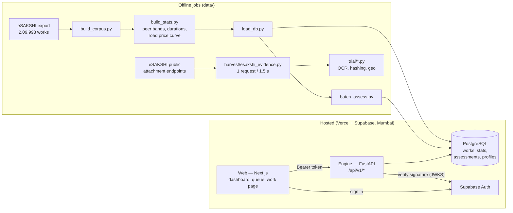

# DRISHTI — technical architecture

*The plain-language version is [HOW-IT-WORKS.md](HOW-IT-WORKS.md). The full design, with the reasoning
behind each choice, is in [`specs/`](specs/): the prototype design (architecture and stack) and the v2
design (12 agents, real evidence).*

---

## 1. The system in one picture



**One work's journey through the engine** (`pipeline/orchestrator.py`):

```
work record ─► 2 DATA VALIDATION ─► 3 AGENTS (each returns an AgentResult) ─► 4 RISK FUSION ─► score, band, parts, priority
                 validation/          agents/<agent>/                         fusion/fuse.py
```

## 2. Components

| Component | Where | What it does |
|---|---|---|
| **Engine** | `apps/engine/drishti/` | Python 3.12 + FastAPI. Validation, agents, fusion, the REST API, auth, migrations. Deployed as a Vercel Service (`drishti.main:app`). |
| **Web** | `apps/web/src/` | Next.js 16 (App Router, React 19), Tailwind 4, MapLibre 6. Pages: `/login`, `/` (dashboard + India map), `/queue`, `/works`, `/work?id=…`, `/how-it-works`. |
| **Database** | Supabase PostgreSQL | Tables below. Row-level security on; the engine connects server-side and applies scoping in every query. |
| **Auth** | Supabase Auth | Email login. The engine verifies the access token itself and reads role + district from `profiles`. |
| **Offline jobs** | `data/` | Build the corpus and statistics, load the database, assess all works, draw map outlines, harvest evidence, run the trial. |
| **CI** | `.github/workflows/ci.yml` | Engine: `ruff` + `pytest`. Web: `tsc`, `eslint`, `next build`. |
| **Hosting** | `vercel.json` | Two services on one domain: `/api/v1/*` → engine, everything else → web. Auto-deploys on push to `main`. |

### Engine layout

| Module | Purpose |
|---|---|
| `agents/contract.py` | `AgentResult` / `Finding` / `Status`; the banned-word guard; `not_built()` placeholder |
| `agents/statistical/` | the **Cost** agent: `cohort.py` (peer statistics store), `band.py` (z-score → risk), `text.py` (bundle & length reading), `unit_rate.py` (road ₹/m), `timeline.py` (overdue works), `agent.py` (puts it together) |
| `validation/` | `checks.py` (issues: BLOCK / WARN / INFO), `timeline.py` (impossible dates judged by quarter and office, Wilson lower bound), `prohibited.py` (object-of-work matcher) |
| `fusion/fuse.py` | Risk Fusion (below) |
| `pipeline/orchestrator.py` | `assess_work()`: validate → run agents → fuse → priority; an agent that raises becomes an `ERROR` result, never a finding |
| `api/routes.py` | REST endpoints (below) |
| `auth.py` | token verification, `Principal`, district scoping, dev mode |
| `reference/*.yaml` | guideline clauses (quoted verbatim), prohibited works (Annexure-II), work categories and types |
| `migrations/*.sql` + `migrate.py` | schema, applied in order |
| `batch.py` | assess many works and write compact rows |

## 3. The agent contract

Every agent returns an `AgentResult`:

```python
AgentResult(agent, status, verdict, risk, confidence, hard, headline, version,
            findings=[Finding(code, text, hard, risk, evidence)], limitations=[...], evidence={...})
```

- `status ∈ {ASSESSED, NOT_APPLICABLE, NOT_ASSESSABLE, NOT_BUILT, ERROR}`. Only `ASSESSED` carries weight.
- `risk` and `confidence` are clamped to 0–1.
- Headlines, findings and limitations are checked against `BANNED_WORDS`; an accusing word raises `ValueError`
  (tested for every word in `tests/agents/test_contract.py`).
- Agents not yet built report `NOT_BUILT`, so every screen shows every slot from day one and nothing pretends
  to have been checked.

## 4. Risk Fusion

`fusion/fuse.py`, ported from the research build's calibrated case builder.

```
weight(agent)   = risk × confidence × reliability(agent)          reliability prior = 0.8
                  soft findings capped at 0.45                     (price alone can't make a work HIGH)
validation      = min(0.30, Σ issue risk)                          (the record alone reaches MEDIUM at most)

score           = strongest weight + 0.45 × (sum of the others)    (corroboration uplift)
                  normalised to ≤ 1.0; shown as 0–100

band            HIGH    score ≥ 0.60, or any HARD finding with risk ≥ 0.60 at confidence ≥ 0.70
                MEDIUM  score ≥ 0.30
                LOW     otherwise
limited         true when 2+ agents could not assess — a low score on thin evidence is not a clean chit

priority        score × (1 + log10(amount / ₹1 lakh)), money factor clamped to 0–3
                (₹1 lakh ×1, ₹10 lakh ×2, ₹1 crore ×3, ₹10 crore ×4)
```

**Attribution:** the stored `parts` add up **exactly** to the score, so an officer sees how much each agent
contributed and can disagree with any single part. The **review queue** is every work with band MEDIUM or
HIGH, ordered by priority.

**Planned (v2):** reliability learned from officer verdicts; a stronger uplift when agents from *different
stages* agree; conflict rules R1–R6 (a reused or misplaced photo voids progress confirmations; each location
fact counts once; a bulk order counts once across Cost and Duplicate; a declared repair downgrades a
duplicate; a document that disagrees with the portal shows both sides; satellite may only withdraw a
finding, never create one).

## 5. Data Validation

`validation/checks.py` returns `Issue`s with a severity:

- **BLOCK** — the record cannot be processed.
- **WARN** — a record inconsistency with weight in fusion (e.g. completed before recommended).
- **INFO** — worth a human's read, almost no weight (e.g. a prohibited-work keyword as the object of the work).

**Impossible dates are judged in context** (`validation/timeline.py`): most "completed before recommended"
records come from bulk entry when eSAKSHI opened in 2023. Each is judged against the rate for its own
recommendation quarter and its office (Wilson lower bound), and offices that entered many at once are listed
once on the dashboard instead of flooding the queue. This took the queue from 847 to 276 works.

## 6. API

All routes are under `/api/v1` and (except health) need a signed-in user. Interactive docs: `/api/v1/docs`.

| Method & path | Returns |
|---|---|
| `GET /health`, `GET /health/keepalive` | liveness; keepalive touches the database so the free tier doesn't sleep |
| `GET /me` | the signed-in user's role, district and name |
| `GET /dashboard/summary` | totals, band counts, review count, money at stake — scoped to the user |
| `GET /dashboard/districts` | per-district counts for the map |
| `GET /dashboard/offices` | offices with concentrated record problems (listed once) |
| `GET /works?q=&district=&type=&band=&page=` | searchable, paged list of works with their band and score |
| `GET /queue?district=&band=&page=` | works needing review (MEDIUM/HIGH), by priority |
| `GET /works/{work_id}` | one work with its full assessment (agent cards, parts, validation); rebuilt on the fly for compact rows |

**Scoping:** `DISTRICT` and `FIELD` users are confined to their district **inside the SQL** of every query
(`_scope()` in `routes.py`), so a mistake in the interface cannot leak another district's works. A work outside
your area returns 404.

## 7. Authentication and roles

1. The web app signs in with Supabase Auth and sends the access token as `Authorization: Bearer …`.
2. The engine fetches the project's public signing keys (`/auth/v1/.well-known/jwks.json`, cached 10 min),
   verifies signature, expiry and audience, then loads `role`, `district_lgd` and `display_name` from
   `profiles`. No profile → 403.
3. Roles: `MINISTRY` (all districts), `DISTRICT` and `FIELD` (one district).
4. **Dev mode** (`DRISHTI_AUTH=dev`): a request may name its role in an `X-Dev-Role` header so the app runs on
   a laptop without Supabase. It is refused whenever the `VERCEL` environment variable is present.

## 8. Database

| Table | Holds |
|---|---|
| `works` | one row per work: ids, place (state/district codes and names, constituency), MP, agency, type, category, description, amount, dates, status, quantity, outside-constituency flag, and `source ∈ {REAL, SCENARIO, LIVE}` so real, planted and live records are never confused |
| `districts` | district code, name, state |
| `cohort_stats` | peer cost bands per level (type×district / type×state / type) — n, p10, p50, p90, sd |
| `duration_stats` | completion-time percentiles per work type |
| `unit_rate_models` | road price-per-metre curve and published rate anchors |
| `timeline_quarters`, `timeline_agencies` | impossible-date base rates by quarter and office |
| `assessments` | per work: score, band, limited, priority, parts, validation, agents, versions, summary `alerts[]`/`headline`, and `compact` |
| `profiles` | user → role, district, display name |

**Fitting the free tier:** storing full agent detail for all 2.1 lakh works took 489 MB of the 500 MB free
database. LOW works with nothing to show are stored **compact** (summary only) and rebuilt when opened →
193 MB.

## 9. Deployment

- **Vercel** project `drishti`: web and engine as Vercel Services from `vercel.json`; production = `main`.
- **Supabase** `drishti-db`, region `bom1` (Mumbai), created through the Vercel marketplace; the engine reads
  `POSTGRES_URL` (transaction pooler) and strips pooler-only URL hints libpq rejects (`config.clean_url`).
- Bulk loads use the session pooler (port 5432) via `data/with_env.py`, which never prints secrets.
- After each deploy: a browser smoke test (login → dashboard → a flagged work).

## 10. Security and privacy

- Secrets live only in environment variables (`.env*` is gitignored; see [SETUP.md](SETUP.md) for names).
- Downloaded evidence (`data/evidence/`), OCR text (`data/trial/cache/`), demo passwords and raw exports are
  gitignored. Trial results are passed through `data/trial/sanitize_results.py` (masks phone and account
  numbers) before commit.
- Public records contain private phone numbers and vendors' bank account numbers: DRISHTI masks both and
  never displays them.
- Maps use only official LGD boundaries.
- Plain, non-accusing language is enforced in code; MPs are never scored.

## 11. Testing

- **Engine:** 141 tests (`pytest`) — agent contract and banned words, every Cost facet, fusion maths,
  validation and impossible dates, orchestrator (an agent crash never becomes a finding), config, migrations,
  API and auth (scoping, dev-mode refusal on Vercel).
- **Web:** typecheck, lint and production build in CI.
- **Agents on real data:** `data/trial/*.py` — every number in [AGENTS.md](AGENTS.md) comes from a saved
  output in `data/trial/results/`.

## 12. Known limits of the current build

- Only the Cost agent, Data Validation and Fusion v1 run in the live engine; the other agents are proven in
  the trial scripts and are being ported one by one (order in [STATUS.md](STATUS.md)).
- The data is a snapshot (26 May 2026); "today" for real works is that date (`DRISHTI_SNAPSHOT_DATE`).
- First load after a deploy takes a few seconds (cold start + aggregation over 2.1 lakh rows).
- Rebuilding the corpus from scratch needs the raw eSAKSHI export from the team's research build
  (see [DATA.md](DATA.md)); the hosted database already holds the result.
