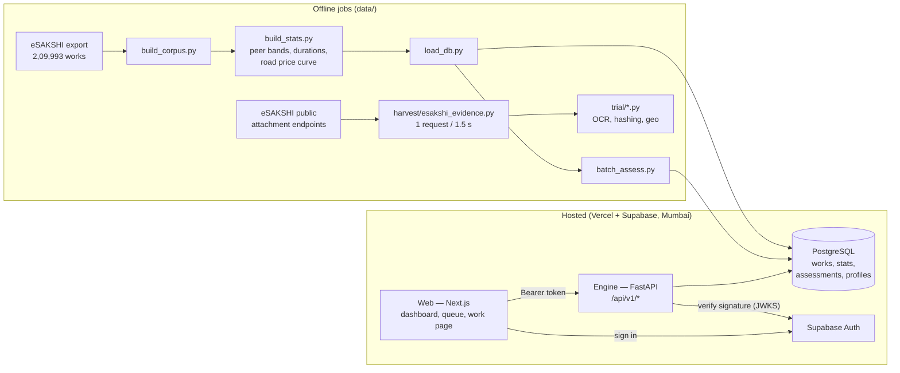

# DRISHTI — technical architecture

*The plain-language version is [HOW-IT-WORKS.md](HOW-IT-WORKS.md). The full design, with the reasoning
behind each choice, is in [`specs/`](specs/): the prototype design (architecture and stack) and the v2
design (12 agents, real evidence).*

---

## 1. The system in one picture



**One work's journey through the engine** (`pipeline/orchestrator.py`):

```
work record ─► 2 DATA VALIDATION ─► 3 AGENTS (each returns an AgentResult) ─► 4 RISK FUSION ─► score, band, parts, priority
                 validation/          agents/<agent>/                         fusion/fuse.py
```

## 2. Components

| Component | Where | What it does |
|---|---|---|
| **Engine** | `apps/engine/drishti/` | Python 3.12 + FastAPI. Validation, agents, fusion, the REST API, auth, migrations. Deployed as a Vercel Service (`drishti.main:app`). |
| **Web** | `apps/web/src/` | Next.js 16 (App Router, React 19), Tailwind 4, MapLibre 6. Pages: `/login`, `/` (dashboard + India map), `/queue`, `/works`, `/work?id=…`, `/presanction`, `/how-it-works`, and the public `/explain` (the Visualization Engine, T092: one work through six animated, replayable steps; no sign-in for the built-in examples). |
| **Database** | Supabase PostgreSQL | Tables below. Row-level security on; the engine connects server-side and applies scoping in every query. |
| **Auth** | Supabase Auth | Email login. The engine verifies the access token itself and reads role + district from `profiles`. |
| **Offline jobs** | `data/` | Build the corpus and statistics, load the database, assess all works, draw map outlines, harvest evidence, run the trial. |
| **CI** | `.github/workflows/ci.yml` | Engine: `ruff` + `pytest`. Web: `tsc`, `eslint`, `next build`. |
| **Hosting** | `vercel.json` | Two services on one domain: `/api/v1/*` → engine, everything else → web. Auto-deploys on push to `main`. |

### Engine layout

| Module | Purpose |
|---|---|
| `agents/contract.py` | `AgentResult` / `Finding` / `Status`; the banned-word guard; `not_built()` placeholder |
| `agents/registry.py` | finds engines by folder (`agents/<id>/engine.py`); the four agents (`CORE`, a quarter of the weight each, T125) and the retired ones (`RETIRED`: stored results still read by name) |
| `agents/time_rules/` | **Time & Rules** (T122): R01 (the 75-day clock, election-code days left out), R06 (impossible dates), R13/R14 (complete within days) from the compliance library; `SANCTIONED_LATE` as an office fact (risk 0.05, never queues alone); `window.py` the comfort window from the form's estimated time to completion, held between the shortest believable time (`reference/time_floors.json`) and eSAKSHI's 90th percentile for the type (`reference/time_bands.json`, `data/build_time_bands.py`); `FINISHED_TOO_FAST` (no site video shows the work) and `PAST_PROMISED_TIME` |
| `agents/compliance/` | the retired Guideline Compliance (T125): rules R01–R14 from `reference/rules.json` (English + Hindi), kept as the library Time & Rules reads |
| `agents/statistical/` | the retired Cost Anomaly (T099: no longer registered; `agent.py` kept so the trials behind FINDINGS re-run). Still shared: `scope.py` (what a description covers: goods/works, bundles, counts), `cohort.py` (peer statistics store), `text.py` (length reading), `unit_rate.py` (road ₹/m), `price_model.py` (word-price model, applied to any description, T051), `agent.py` (like-for-like peers + the price model must agree) |
| `agents/dup_split/` | **Duplicate Work** (T100): `repeat.py` (`RepeatIndex`, built once by the batch, per district by the API) finds sanctioned works of the same kind at the cost form's map pin (50 m; linear works by both ends), the work the form declares it continues, look-alikes by words (notes), and the strictest split (every piece 96–100% of a limit); `match.py` holds the word readers (place words, sides, numbers, Hindi/English synonyms) and the grouping it reuses |
| `agents/delay/` | the retired Fund Flow (T125; stored id `delay`): library code only |
| `records.py` | one reading of a work's record (T056): every column the engines read checked once where the indexes, the cohort statistics and the orchestrator take a work (text as written, numbers from any number type or "1,00,000", ISO and Indian day-first dates, a clear yes/no), malformed values dropped, never guessed, so no row can stop the batch; a clean row passes through uncopied |
| `agents/evidence.py` | one reading of a work's evidence facts for every engine and index (T056): files, stamps, certificates, payments, fingerprints and photo readings checked once; malformed parts dropped, never guessed, so no evidence row can stop an engine or the batch |
| `agents/office_patterns/` | the retired Office Patterns (T125; its index still feeds `GET /dashboard/office-habits`), as built on 2 Oct 2026: `index.py` counts per office, live from all works, how many works are priced just under a limit (96-100% of ₹5 lakh, ₹10 lakh, ...) and how many constructions are recorded complete within 7 days of sanction; an office is "routine" only when its Wilson lower bound is at least 3× the national share (30+ priced works, 15+ built). `agent.py`: a work just under a limit from a routine office gets `PRICED_AT_LIMIT` (risk 0.30, weight 0.10: corroborates, never queues alone); the office's after-sanction habit is told as a fact (R14 counts the work itself) |
| `agents/site_progress/` | **Site Progress** v3 (T124): `visits.py` reads a work's site videos (`work["site_visits"]`, readings made once by the video job), `sitemap.py` the site from the form's map pins (a compact site with a radius, or a linear one in 50 m stretches; 20 m GPS margin), `agent.py` the six checks (footage seen before, the same place as another undeclared work, not filmed here by GPS **and** views, the claim not shown twice in a row, complete not shown, already built at the start); a visit that is unsealed, not filmed in the app or whose motion disagrees with the picture is not accepted (a note, never a finding). `photos.py` is v2 (photos, CLIP, plaque OCR), kept for the photo trial; `readers.py` the optional Gemini reader (daily cap, cache) |
| `video/` | the site video job (T124), run **outside** the engine on a machine with OpenCV 4 (`data/requirements-video.txt`): `reader.py` (frames every 0.5 s, 256-bit fingerprints, ORB + RANSAC view matching, change at the same view, optical flow, face blurring that fails closed), `visit.py` (one video → readings and kept frames), `job.py` (uploaded visits → read, video deleted, blurred viewpoint frames kept; `data/build_site_visits.py`) |
| `capture.py`, `api/site_visits.py` | site visits (T123): a capture token signed with `DRISHTI_CAPTURE_SECRET` (7 days, bound to the visit and the person), Supabase Storage signed upload/download links with the service role key (`LocalStore` for trials); routes answer 503 until the secret, storage and migration 014 exist |
| `agents/paperwork/`, `agents/photo_evidence/` | retired (T125): Paperwork (certificates vs the portal), Photo Evidence (reuse, place, time of photos); library code only |
| `agents/cost_estimate/` | **Cost** (Cost v3, T097; the Cost slot since T099): reads the agency's cost estimate form (`work["cost_form"]`); `reference.py` builds price-per-unit groups from a state's real works (`reference/cost/<state>.json`, by `data/build_cost_reference.py`) and compares only tight groups priced in the form's own unit of size; `agent.py` asks about a confirmed quantity above what the size needs (`cost_form/norms.py`) or a price above the standard item **and** the MP's amount. T121: `rates.py` gives each confirmed line a fair rate (its SoR item from `reference/cost/sor/<state>.json`, else `RateIndex`: 3+ other agencies' rates in the district on 5+ forms of the last 183 days, never its own, capped at SoR + 15%), `whole.py` the fair estimate (quantities held to the size + 10%) and `ESTIMATE_ABOVE_FAIR_PRICE` when 60%+ of the money is priced and the gap is 15%+ and Rs 50,000+; a form's agency is `rates.agency_of` (who saved it, else the agency it names) and its month the form's own filing date. Plans `docs/plans/T097-cost-agent-v3.md`, `T120-four-agents.md` §6 |

**One brain per engine (T051).** An engine's reasoning is a function of the work plus stored tables or
coefficients (`cohort_stats`, `engine_models`, `reference/*`). No engine reads an answer stored
per work by an offline job: a recommendation the system has never seen goes through exactly the same code
as a corpus work, and "compared, nothing found" is only said after a comparison ran.
| `validation/` | helpers Guideline Compliance uses: `timeline.py` (impossible dates judged by quarter and office, Wilson lower bound), `prohibited.py` (object-of-work patterns), `pii.py`. The separate Data Validation step was removed in T053 |
| `fusion/calibrated.py`, `fusion/fuse.py`, `fusion/reasons.py` | the risk score (v3 calibrated evidence fusion; v2 rollback), bands and top-3 reasons in English and Hindi (below) |
| `evaluation/` | the test country (2 Oct 2026): `synthetic.py` builds a seeded, made-up eSAKSHI (~19,000 works shaped like the real export) with labelled planted problems and look-alikes; `stats.py` rebuilds the statistics from it; `harness.py` runs the pipeline blind and scores recall, queue precision and false alarms. Used by `tests/evaluation/` (CI gate) and `data/trial/synthetic_eval.py` |
| `pipeline/orchestrator.py` | `assess_work()`: run agents → fuse → priority; an agent that raises becomes an `ERROR` result, never a finding |
| `explain.py` | the Visualization Engine's trace (T092): runs one work through `assess_work()` and lays out each step for `/explain`: the masked input and what was hidden, the description cut into coloured runs (place, size or count, construction, purchase, not-allowed word, hidden detail) with the facts the readers found, every engine's result with the data its picture needs, and the score's arithmetic replayed from `fusion/calibrated.py` (tested to equal the pipeline's score). It computes no score of its own |
| `cost_form/` | the cost estimate form (Cost v3, T093): `catalog.py` reads every field from `reference/cost_form.yaml` (one source for the web form, the checks and the spec), `materials.py` suggests which known material a typed item is (the person confirms it), `validate.py` the fix / confirm checks. The Cost v3 engine that judges a submitted form is T097 (`docs/plans/T097-cost-agent-v3.md`). T134: `pswif.py` reads the website's work intelligence form (PSWIF v1.0, `apps/web/forms/pre-sanction-work-intelligence-form.html`, flat fields from its `serialize()`) into the engine's cost form and a work record (only what the agency wrote; a BOQ line's justification confirms that line); `versions.py` lists the fields a form version never asks, which the required checks then skip |
| `api/routes.py` | REST endpoints (below) |
| `auth.py` | token verification, `Principal`, district scoping, dev mode |
| `reference/*.yaml` | guideline clauses (quoted verbatim), prohibited works (Annexure-II), work categories and types |
| `migrations/*.sql` + `migrate.py` | schema, applied in order |
| `batch.py` | assess many works and write compact rows |

## 3. The agent contract

Every agent returns an `AgentResult`:

```python
AgentResult(agent, status, verdict, risk, confidence, hard, headline, version,
            findings=[Finding(code, text, hard, risk, evidence)], limitations=[...], evidence={...})
```

- `status ∈ {ASSESSED, NOT_APPLICABLE, NOT_ASSESSABLE, NOT_BUILT, ERROR}`. Only `ASSESSED` carries weight.
- `risk` and `confidence` are clamped to 0–1.
- Headlines, findings and limitations are checked against `BANNED_WORDS`; an accusing word raises `ValueError`
  (tested for every word in `tests/agents/test_contract.py`).
- Agents not yet built report `NOT_BUILT`, so every screen shows every slot from day one and nothing pretends
  to have been checked.

## 4. Risk score (fusion v3, 2 Oct 2026; v2 kept as a rollback)

`fusion/calibrated.py` (v3, the default) and `fusion/fuse.py` (dispatch + v2). The score is **the chance a
work is worth an officer's look**, built from how often each kind of flag was read as worth checking when
the team read flags by eye (`reference/reliability.json`; every entry names its labels file).

```
a finding   p = hit rate × strength
            hit rate = (worth + 1) / (read + 4)      e.g. R12 46 of 48 read → 0.94; repeat while open
                                                     33 of 74 → 0.45; never read → 1 in 4 (the prior)
            strength = the finding's risk / its reference risk (graded rules count in proportion)
an engine   its findings as independent evidence, one kind of finding counted once (its strongest)
the work    1 − ∏(1 − p_engine) over the counted engines (registry weight > 0)
floor       a serious rule breach (hard, risk ≥ 0.6) lifts the score to High, two to Critical (own part)
bands       CRITICAL ≥ 0.80 and two counted engines each ≥ 0.15 (or a serious breach and another engine)
            HIGH ≥ 0.50 (more likely than not worth a look) · MEDIUM ≥ 0.25 · LOW
parts       each engine's share ∝ −ln(1 − p): order-free, and the parts add up exactly to the score
reasons     the top three parts, English + Hindi, each with the measured hit rate behind it
            ("flags like this read worth a look X times in Y")
priority    score × (1 + log10(amount / ₹1 lakh)), money factor clamped to 0–3 (unchanged)
```

**Why v3:** in v2 no single engine could reach High (Guideline Compliance at its strongest gave 0.18 of the
0.22 needed), so a split, a repeat or a temple work found with certainty stayed Medium unless a second engine
happened to fire: on the planted test 4 of 50 fakes reached the queue (T080), on the synthetic countries 4%.
v3 lets one well-measured finding queue a work on its own, and keeps rare, unread or weakly measured findings
out: a kind of flag never read by eye counts 1 in 4 and cannot queue a work alone (proof before launch, in
numbers). Splits and repeats stay Medium alone because they read right only about half the time (45-52%).
Measured in [`trial/FINDINGS.md`](trial/FINDINGS.md) "2 Oct 2026".

**Learning loop (T070):** `Reliability.with_verdicts({code: (worth, read)})` adds officer verdicts to the
counts, so the score learns which flags are right without retuning a cut-off.

**One case, one queue row:** a Duplicate & Split group (one purchase entered as many works, one site split
into pieces) is stored with `case_id` / `case_size` (migration 012); the queue shows the group once, by its
highest-priority work ("One case: N alike works, shown once").

**Rollback:** `DRISHTI_FUSION=v2` brings back the T050 weighted sum unchanged
(`0.30 compliance + 0.20 cost + 0.20 duplicate/split + 0.20 fund flow`; floors as above;
CRITICAL ≥ 0.30 · HIGH ≥ 0.22 · MEDIUM ≥ 0.15). Both versions run through the same tests
(`tests/fusion/test_fuse.py` pins v2, `test_calibrated.py` checks v3).

**The four agents (T125):** Cost, Duplicate Work, Time & Rules and Site Progress count, a quarter of the
weight each. A new kind of finding counts at the 1-in-4 prior until it is read by eye, so none of the new checks
(the whole estimate, the comfort window, the site videos) can queue a work alone yet; a late sanction is a
`design` entry of 0.05 and never queues. The retired engines no longer run; their stored results read by name
until the next batch replaces them.

## 5. Record checks (inside Guideline Compliance)

The separate Data Validation step was removed in T053: it was shown, not counted, and repeated Guideline
Compliance (R06 impossible dates, R11 missing data) with the older prohibited-work matcher.

**Impossible dates are judged in context** (`validation/timeline.py`): most "completed before recommended"
records come from bulk entry when eSAKSHI opened in 2023. Each is judged against the rate for its own
recommendation quarter and its office (Wilson lower bound), and offices that entered many at once are listed
once on the dashboard instead of flooding the queue. This took the queue from 847 to 276 works.

## 6. API

All routes are under `/api/v1` and (except health) need a signed-in user. Interactive docs: `/api/v1/docs`.

| Method & path | Returns |
|---|---|
| `GET /health`, `GET /health/keepalive` | liveness; keepalive touches the database so the free tier doesn't sleep |
| `GET /me` | the signed-in user's role, district and name |
| `GET /dashboard/summary` | totals, band counts, review count, money at stake — scoped to the user |
| `GET /dashboard/districts` | per-district counts for the map |
| `GET /dashboard/offices` | offices with concentrated record problems (listed once) |
| `GET /dashboard/office-habits` | offices with an unusual habit (Office Patterns: pricing works just under a limit, or recording constructions complete within days of sanction), each with its count, its share and the national share (scoped, cached) |
| `GET /works?q=&district=&type=&band=&page=` | searchable, paged list of works with their band and score |
| `GET /queue?district=&band=&page=` | works needing review (HIGH/CRITICAL), by priority; a Duplicate & Split case (`case_id`) appears once, by its highest-priority work, with `case_size` |
| `GET /works/{work_id}` | one work with its full assessment (agent cards, parts, validation); rebuilt on the fly for compact rows |
| `GET /presanction/options`, `POST /presanction` | the pre-sanction check (T064): a typed-in recommendation → Green / Amber / Red with the engines' reasons; nothing stored |
| `POST /explain` | the Visualization Engine (T092): a typed-in work (a recommendation, or sanctioned / completed with its dates) → the step-by-step trace of `explain.py`, checked against the real works of the chosen district; nothing stored. The page's built-in examples are a static file (`apps/web/public/explain/examples.json`, built by `data/trial/explain_examples.py`), so they need no sign-in |
| `GET /site-visits/{work_id}`, `POST /site-visits/start`, `POST /site-visits/{visit_id}/upload`, `POST /site-visits/{visit_id}/done` | site visits (T123, migration 014): the work's site (from the form's map pins), its viewpoints and visits; start issues a capture token; upload returns a signed storage link; done records the seal (SHA-256), the GPS and motion log (≤ 400 KB) and the agency's claim. District walls as everywhere; 503 until set up |
| `POST /cost-forms`, `GET /cost-forms/{work_id}` | the agency's saved form (T099, migration 013): a draft, or submitted when `ready` (else 422 with the issues; 409 once submitted); the MP's amount always from the record; submitting re-assesses the work. The read returns `earlier_candidates`, the sanctioned works the agency must answer about (T100) |
| `POST /work-form/check` | the website's work intelligence form (T134): the form's flat JSON (≤ 400 KB; 413 above) → its district (by the name in section C; 422 without one, 404 if unknown or outside the user's area), the form's own fix list and the four agents' trace (`explain.py`), checked against the district's saved works and forms; nothing stored, open to the public view. The page's twelve example filings are a static file (`apps/web/public/work-form/examples.json`, built by `data/trial/work_form_examples.py`) |
| `GET /cost-form/catalog?work_type=`, `POST /cost-form/validate` | the cost estimate form (Cost v3, T093): the fields for a work type from `reference/cost_form.yaml`, and the checks made while it is filled (fix / confirm, never a flag, never a reference price; any body gets an answer). Spec `docs/specs/2026-10-03-cost-estimate-form.md` |

**Scoping:** `DISTRICT` and `FIELD` users are confined to their district **inside the SQL** of every query
(`_scope()` in `routes.py`), so a mistake in the interface cannot leak another district's works. A work outside
your area returns 404.

## 7. Authentication and roles

1. The web app signs in with Supabase Auth and sends the access token as `Authorization: Bearer …`.
2. The engine fetches the project's public signing keys (`/auth/v1/.well-known/jwks.json`, cached 10 min),
   verifies signature, expiry and audience, then loads `role`, `district_lgd` and `display_name` from
   `profiles`. No profile → 403.
3. Roles: `MINISTRY` (all districts), `DISTRICT` and `FIELD` (one district).
4. **Open to view (T130):** every read-only route uses `viewer` in `auth.py`. A request with no session (or a
   stale one) is the `PUBLIC` viewer of all districts, so anyone who opens the site sees the scored works without
   signing in. Routes that store something (`/cost-forms`, `/site-visits/*`) keep `current_user` and answer 401
   without a sign-in; the web app offers "Staff sign in" for them. The browser only ever holds the Supabase URL and
   anon key; every table has row-level security with no policies, so that key reads and writes nothing directly.
   **Prototype examples (T132):** the web app answers a visitor with no session from a static file instead of the
   engine: `apps/web/public/showcase/examples.json` (ten works, built by `data/trial/showcase_examples.py`) serves
   `/me`, the dashboard, the queue, the works list and those ten works' pages (`apps/web/src/lib/showcase.ts`, hooked
   into `api()`). The pre-sanction check, Step by step and every signed-in request still go to the engine.
   `NEXT_PUBLIC_SHOWCASE=0` turns it off; the engine's own `PUBLIC` answers above are unchanged.
5. **Dev mode** (`DRISHTI_AUTH=dev`): a request may name its role in an `X-Dev-Role` header so the app runs on
   a laptop without Supabase. It is refused whenever the `VERCEL` environment variable is present.

## 8. Database

| Table | Holds |
|---|---|
| `works` | one row per work: ids, place (state/district codes and names, constituency), MP, agency, type, category, description, amount, dates (recommended, `sanction_date` since migration 011, completed), status, quantity, outside-constituency flag, and `source ∈ {REAL, SCENARIO, LIVE}` so real, planted and live records are never confused |
| `districts` | district code, name, state |
| `cohort_stats` | peer cost bands per level (type×district / type×state / type) — n, p10, p50, p90, sd |
| `duration_stats` | completion-time percentiles per work type |
| `unit_rate_models` | road price-per-metre curve and published rate anchors |
| `timeline_quarters`, `timeline_agencies` | impossible-date base rates by quarter and office |
| `assessments` | per work: score, band, limited, priority, parts, validation, agents, versions, summary `alerts[]`/`headline`, `compact`, and `case_id` / `case_size` (migration 012: the Duplicate & Split group a work belongs to, so the queue shows a case once) |
| `work_signals` | per work and engine: facts computed offline. Since T051 no core engine uses it (kept for evidence-based checkers) |
| `engine_models` | small learned models an engine applies to any work, as JSON: the cost engine's word-price model (migration 008, `data/build_price_model.py`) |
| `dashboard_cache` | saved dashboard answers, emptied whenever works are re-assessed |
| `cost_forms` | the agency's cost estimate form per work, draft or submitted (migration 013) |
| `site_visits` | one row per site visit (migration 014): kind (baseline / monthly / check / final), status (started → uploaded → read or rejected), the claim, the seal, the GPS and motion log, the readings and the kept frames' paths; the video's path is cleared when the job deletes it |
| `profiles` | user → role, district, display name |

**Fitting the free tier:** storing full agent detail for all 2.1 lakh works took 489 MB of the 500 MB free
database. LOW and MEDIUM works are stored **compact** (summary only) and rebuilt when opened →
312 MB with the four engines and their offline signals (measured on a full local load, 30 Sept 2026).

## 9. Deployment

- **Vercel** project `drishti`: web and engine as Vercel Services from `vercel.json`; production = `main`.
- **Supabase** `drishti-db`, region `bom1` (Mumbai), created through the Vercel marketplace; the engine reads
  `POSTGRES_URL` (transaction pooler) and strips pooler-only URL hints libpq rejects (`config.clean_url`).
- Bulk loads use the session pooler (port 5432) via `data/with_env.py`, which never prints secrets.
- After each deploy: a browser smoke test (login → dashboard → a flagged work).

## 10. Security and privacy

- Secrets live only in environment variables (`.env*` is gitignored; see [SETUP.md](SETUP.md) for names).
- Downloaded evidence (`data/evidence/`), OCR text (`data/trial/cache/`), demo passwords and raw exports are
  gitignored. Trial results are passed through `data/trial/sanitize_results.py` (masks phone and account
  numbers) before commit.
- Public records contain private phone numbers and vendors' bank account numbers: DRISHTI masks both and
  never displays them.
- Maps use only official LGD boundaries.
- Plain, non-accusing language is enforced in code; MPs are never scored.

## 11. Testing

- **Engine:** 693 tests (`pytest`, 4 Oct 2026), plus 14 video tests that run where OpenCV is installed
  (`tests/video/`, skipped in the engine's own environment) — agent contract and banned words, the four agents
  (Cost with the whole estimate, Duplicate Work, Time & Rules, Site Progress v3) including NOT_ASSESSABLE cases,
  the site-visit routes and the video job end to end, the risk score, bands and reasons, migrations, fusion maths,
  validation and impossible dates, orchestrator (an agent crash never becomes a finding), config, migrations,
  API and auth (scoping, dev-mode refusal on Vercel).
- **Quality gate (2 Oct 2026):** `tests/evaluation/test_quality_gate.py` runs the whole pipeline on two small
  seeded made-up countries in CI: each planted problem must be found by the engine meant for it (T125: the
  dates by Time & Rules, map pins and splits by Duplicate Work), R13 must reach the queue, look-alikes (opposite
  sides of one road, a repair of another asset, a pin next door, a declared continuation) must be left alone,
  queue precision ≥ 0.75 and ordinary works queued ≤ 0.5%. Kinds the four agents no longer check stay planted with
  no engine meant for them. `test_random_environment.py` feeds 400 malformed records (empty fields,
  impossible dates, other scripts, sums of zero or crores) and checks no engine crashes, parts add up, the
  same work gives the same answer, and load order and capitals change nothing. Since T056 it also puts 300
  damaged rows inside the corpus the indexes and statistics are built from (none may stop them), and gives a
  loosely typed twin of every work (dates as text, amounts as Decimal or "1,00,000", codes as numbers) the
  same answer finding for finding (`records.py`).
  `tests/api/test_api_at_scale.py` (T056) runs the API on the test country's 1,302 works with messy text and
  evidence: every endpoint and role, no 500, district walls, the queue against the stored bands, and no returned text
  holding anything the masker would hide.
  `tests/test_explain.py` (T092): the Visualization Engine's trace gives the pipeline's own score on 60 works, its
  coloured runs rebuild the masked description exactly, nothing in it is private or accusing, and odd records never
  break it; the API test also runs `POST /explain` (sign-in, district walls, bad bodies).
  `test_random_evidence.py` (T056) does the same for evidence: 250 works with malformed files, stamps,
  certificates and photo readings must not stop an index or an engine; the order files were attached in and a
  junk entry beside them change nothing.
- **Web:** typecheck, lint and production build in CI.
- **Agents on real data:** `data/trial/*.py` — every number in [AGENT-CATALOG.md](AGENT-CATALOG.md) comes from a saved
  output in `data/trial/results/`.

## 12. Known limits of the current build

- The four agents (Cost, Duplicate Work, Time & Rules, Site Progress) and the risk score run in the engine. Cost's
  whole estimate needs real forms and the Schedule of Rates files (T096); the comfort window needs the form's
  estimated time; Site Progress needs filmed visits (the capture page, migration 014, `DRISHTI_CAPTURE_SECRET`, a
  storage bucket and the video job). Until then those parts answer "not judged" / "does not apply", never a pass,
  and their thresholds are design values awaiting T126's field trial.
- Learning runs offline in `data/` (`build_stats.py`, `build_price_model.py`, `build_evidence.py`,
  `build_generic_words.py`) and is stored as tables, coefficients or reference files, never as per-work
  answers (T051); after a data rebuild the hosted database must be reloaded (`load_db.py` → `batch_assess.py`).
- The data is a snapshot (26 May 2026); "today" for real works is that date (`DRISHTI_SNAPSHOT_DATE`).
- First load after a deploy takes a few seconds (cold start + aggregation over 2.1 lakh rows).
- Rebuilding the corpus from scratch needs the raw eSAKSHI export from the team's research build
  (see [DATA.md](DATA.md)); the hosted database already holds the result.
