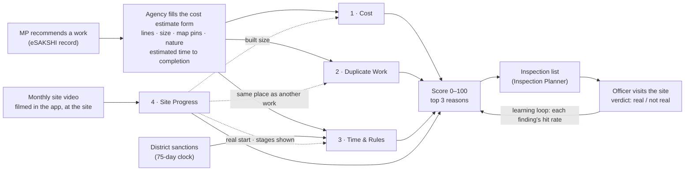

# T120 · DRISHTI's four agents: the prototype architecture

**Cost · Duplicate Work · Time & Rules · Site Progress**

- **Who it is for:** the team, to build it, and the deck, to explain it. It is written in plain words; §18 explains
  the few technical terms.
- **Status:** a plan, 3 Oct 2026. §15 lists what already exists and what has to be built. Anything marked "to build"
  does not exist yet.
- **Numbers:** every number comes from a saved script output or a named public source (§17). Examples marked
  *illustration* use made-up numbers to show how a rule works; they are not findings.

---

## The four agents on one page

| Agent | The one question it answers | What it reads | It asks an officer to check when… | It never flags… |
|---|---|---|---|---|
| **1 · Cost** | Is every line of the estimate fairly priced for this district, and is the whole estimate fair? | The agency's cost estimate form: every material, quantity and rate, the size, the site conditions, the MP's amount | The whole estimate is clearly above its fair price, and it names the lines that make up the gap | One high line that an honest reason can explain, or a typing mistake (the form catches those while it is filled in) |
| **2 · Duplicate Work** | Is this work already sanctioned here, or one job cut into pieces to stay under a limit? | The form's map pins, the agency's own answers about look-alike works, and the district's sanctioned works | Any one of these: <ul><li>a sanctioned work of the same kind within 50 m;</li><li>a declared rebuild of a work finished under 3 years ago;</li><li>a group where every piece is 96–100% of a limit.</li></ul> | Look-alike wording alone. It is shown as a note, and the agency must answer it. |
| **3 · Time & Rules** | Was it sanctioned on time, and is it being finished in a believable time? | The record's dates; the form's **estimated time to completion**, kind and size of work; the site videos | Either of these: <ul><li>it was finished faster than the work can be built, and the videos do not show it being built;</li><li>it is unfinished well past its own promised time.</li></ul> | A late sanction alone (6 in 10 works are late, which is an office problem rather than one work's fraud), or a fast finish the videos show to be real |
| **4 · Site Progress** | Do the monthly site videos show real, new work, at this work's site, for this work only? | A short video filmed in the app at the site each month, with its GPS points and motion data, plus the agency's one-line claim for that month | Any one of these: <ul><li>the footage was used before;</li><li>it was not filmed at this site;</li><li>the claimed stage is not shown two visits running;</li><li>"complete" is claimed but the site is not finished.</li></ul> | One bad month, or a dark or short video (the app asks for a retake while the person is still at the site). Slow progress alone is also not flagged here. |

**The idea in one line:** the record cannot prove anything, so each agent takes its certainty from something that can:
- **Cost:** the official rates;
- **Duplicate Work:** a map pin and the agency's own signed answers;
- **Time & Rules:** the agency's own promised time, checked against what the work needs;
- **Site Progress:** the same fixed spots on the site, filmed every month.

---

## 1. What the owner asked (3 Oct 2026)

- **Cost:** "Not just … catch only the obvious fraud. Check the cost of each of the materials against baselines in the
  district etc, along with all the other fields, and THEN judge the collective."
- **Four agents only:** Cost, Duplicate, Site Progress, and Temporal / Guidelines.
- **Temporal / Guidelines** checks two things:
  - whether a work was sanctioned past the 75-day limit;
  - whether a work finished too early or is taking too long, using a form field **"Estimated time to completion"**.

  It first checks that the estimate is accurate for the size and type of work, then builds a **comfort time zone**.
  Finishing before the zone, or still being unfinished after it, is flagged. The limit must "not punish good work".
- **Site Progress:**
  - a monthly video, with GPS and the person's location on a small local map;
  - "every movement making a difference";
  - track which areas of the site were shown, so a new area cannot be passed off as progress;
  - judge real monthly progress, and catch a video reused across sites.

  It must not flag everything, must not flag nothing, and must not be easy to get around. The owner also asked:
  "Is this architecture good, can you improve it?" (§9.2 answers that).
- **For every agent:** "no guesswork, … no flagging for reasons that could be minor mistakes, just flagging fields that
  are likely to actually be fraud, lower false positives."

## 2. The problem, in measured numbers

**The scale.** eSAKSHI, the MPLADS portal, lists **2,09,993 works**. Its public dashboard tables, downloaded on
2 Oct 2026, hold **40,935** of them with dates.

**Delays are normal, not rare.**

| What | Measured |
|---|---|
| Works sanctioned more than 75 days after the MP's recommendation | **60%** (9,401 of 15,662 dashboard works) |
| Sanctioned more than 45 days after (if the 2023 rule says 45, see T001) | **76%** |
| Recommendation to sanction | median **90 days** |
| Sanction to completion | median **209 days** |
| Works that miss the one-year target | 71–77% (research export) |
| Works recommended Apr 2023 – May 2024 still not complete two years later | 40,489 of 97,808 (41%, ₹2,178 cr) |

**Some works are "finished" impossibly fast.**
- 832 works (7.2%) were recorded complete within 7 days of their sanction.
- This includes **195 constructions of ₹5 lakh or more**.
- One community hall in ten was recorded complete within about a day of its sanction.
- When the team read such records by eye, **25 of 25** were worth checking (rule R14).

**What a record can tell about price is very little.**
- Records give no width or thickness: **0 of 1,129** Uttar Pradesh CC-road records state a width.
- Prices differ by place. The median CC road per metre is **Rs 4,000** in Ghazipur and **Rs 12,259** in Mahrajganj.
- A price check from the record alone found **0 real cases in 15** questions.
- The old price check caught a doubled price only **18%** of the time.

**Repeats are hard to see in words.** Even the strictest wording rule is right only 13 times in 16, and finds just
12% of repeats.

**Photos prove little today.**
- **A quarter** of completed dashboard works carry **no picture at all** (9,300 of 36,508).
- On the 321 pilot photos, 0 kept the phone's GPS data: uploading strips it.
- Five identical files sit on different works, and two of those need checking.

## 3. Five rules every agent follows

1. **Flag only what is likely fraud or a serious breach.** A typing mistake is fixed on the form while it is filled
   in. It is never flagged later.
2. **Ask, never accuse.** Every flag says "needs checking" and shows the facts behind it. The words fraud, corrupt,
   scam and guilty are rejected by the engine (`agents/contract.py`).
3. **"Couldn't check" is a status, never a low score.** When an agent lacks what it needs, it says so plainly.
4. **Proof before launch.** A check is switched on only after it meets its target on planted cases and on real cases
   read by eye (§14).
5. **Simple first.** Use arithmetic and maps where they are enough, and use AI only where nothing simpler works. Only
   one step in the whole system needs an AI model: Site Progress judging the agency's claim against the picture.

## 4. The whole system

**A work's life, step by step:**

| # | When | Who | What happens | Agents that check |
|---|---|---|---|---|
| 1 | Day 0 | MP | Recommends the work on eSAKSHI (type, amount, a short description) | none |
| 2 | Before sanction | Implementing agency's engineer | Fills the cost estimate form: every line, the size, map pins (both ends for a road), the nature of the work (new or a continuation), answers about look-alike sanctioned works, and the estimated time to completion | Cost, Duplicate Work, Time & Rules (is the estimate believable?) |
| 3 | Sanction | District authority | Sanctions the work, with the agents' answers in front of it | Time & Rules (the 75-day clock) |
| 4 | Before work starts | Agency engineer | **First site video**: the site before work, its fixed viewpoints, its site map | Site Progress (the baseline); Duplicate Work (is something already built here?) |
| 5 | Every month | Agency engineer | A monthly video from the same viewpoints, plus a one-line claim ("walls up to lintel level") | Site Progress; Time & Rules (on track?) |
| 6 | At random | Inspecting officer, or someone other than the agency | An unannounced check video within 48 hours | Site Progress |
| 7 | Completion | Agency | The final video, and the completion entered on eSAKSHI | Site Progress (is "complete" shown?); Time & Rules (too fast? too late?) |
| 8 | After | Officer | Inspects the works on the list and records a verdict | The learning loop updates each finding's hit rate |

---

## 5. Why these four and nothing else

| Kept | Because |
|---|---|
| Cost | Money is the scheme. With the form, a price can finally be compared like with like: the same item, the same size, the same district. |
| Duplicate Work | Funding one asset twice, and splitting one job to stay under a limit, are the two classic leaks. Map pins and the strictest split make both certain (§7). |
| Time & Rules | Dates are hard facts. "Finished faster than it can be built" was right 25 of 25 times when read by eye. |
| Site Progress | It is the only agent that looks at the ground. It turns "paid for" into "built". |

§12 lists what is removed and what each removed check had measured.

---

## 6. Agent 1 · Cost: every line against the district's rates, then the whole estimate

### 6.1 Why it changes

The owner's point is right, and the numbers show it:
- **The old record check (retired)** caught a doubled price 18% of the time and a tripled price 39% of the time. With
  no size in the record, smaller mark-ups hid in normal price differences.
- **Today's form check (T097)** compares the price of one standard item, such as a solar light, with real works.
  - On 42 real Uttar Pradesh works at their real prices, it asked about none.
  - It caught every planted 1.5× price (42 of 42).
  - It caught a 1.25× price only 9 times in 42, and a 1.1× price never.
- **What the form check cannot see** is the usual way an estimate is padded: every rate a little high, a few extra
  bags, a "far" sand source.

### 6.2 How it works, in five steps

1. **Read every line.**
   - The form already recognises 22 common materials, including labour: cement, steel, sand, aggregate, bricks,
     paver blocks, ready-mix, bitumen, poles, LED fittings, solar panels, batteries, and more.
   - It turns every unit (bags, quintals, brass, cft) into one unit per material (`reference/cost_form.yaml`).
2. **Price each line** against the district's fair rate (§6.3).
3. **Check each quantity** against what the size needs. Engineering norms give, for example, the cement for each
   cubic metre of concrete, the bricks for each cubic metre of wall, and the pavers for each square metre with
   wastage (`cost_form/norms.py`, built).
4. **Check every other field** (§6.4).
5. **Judge the whole estimate** (§6.5). Rebuild a fair estimate from the same size, the needed quantities and the fair
   rates, then compare the two totals.

### 6.3 Where a district's fair rates come from

| Order | Source | Covers | State today |
|---|---|---|---|
| 1 | **The state's Schedule of Rates (SoR):** the government's own rate for each item, with the additions it sets for area and carriage | Building materials, labour, construction items | To be digitised (T096). The government sites (.gov.in) are blocked from our cloud, so this needs a teammate on an Indian connection. |
| 2 | **The district's own recent rates:** what other agencies in the same district entered for the same material in the last 6 months | Market items not in the SoR; local prices | Grows as forms are filed. Counted only with 5+ forms from 3+ agencies; an agency never counts in its own baseline. |
| 3 | **Real works of the same standard item** in the district or state, plus GeM (the Government e-Marketplace) prices | Lights, masts, panels, batteries, CCTV, equipment | Built for 7 states (T097, T099) |
| — | The state's minimum wage | The lowest a labour rate can be | To be digitised (T096) |

**Lines priced "as per SoR" are a fact check, not a judgement.**
- Government estimates are normally built from the state's SoR, and the form asks each line's basis and SoR item code.
- When a line names an SoR item, its rate must be that item's own rate, plus the additions the SoR itself allows here.
- The form shows the SoR rate as soon as the code is typed. A different rate needs a reason, so a wrong code is
  corrected on the spot rather than flagged later.

### 6.4 Checking every field, not only prices

| Field on the form | What the agent checks | What a difference does |
|---|---|---|
| Size (length, area, count, capacity) | A road's length against the distance between its two map pins; later, against the length filmed on site (Site Progress) | Before sanction, a size the map cannot hold must be fixed on the form. After the work, a built size smaller than the estimate's is a finding. |
| Each quantity | Against what the size needs (the norms) | The extra quantity × the rate counts in the gap |
| Each rate | Against its SoR code, the district's rate, or the standard item | The extra rate × the quantity counts in the gap |
| Labour days | Against the labour the quantities need (the SoR's analysis of rates) | Counts in the gap |
| Charges (contingency, GST, labour cess, supervision) | Contingency within the state's cap; GST at the item's rate; supervision only where the state allows it | Over-charges count in the gap |
| Site conditions (terrain, access, distance to sand, stone and cement, lost months) | Against the map pin: the terrain and road access come from the map, not from typing | A hard site the map confirms widens the fair band. A claim the map contradicts does not, and it is listed. |
| The MP's amount | The estimate against the MP's amount | More than 10% over needs a reason on the form (the owner's margin) and is the verdict's second signal |
| Standard items (lights, masts) | The price per unit against the district's real works of that item: more than 25% above the 98th percentile (the owner's margin) | Counts in the gap, and is named |

### 6.5 Judging the whole estimate

- **Fair estimate:** for every line that has a fair rate, the quantity the size needs × the fair rate. Add every line
  that could not be compared, at the agency's own value, and the correct charges.
- **Gap:** the agency's total minus the fair estimate.

**The agent asks only when all three of these hold:**
1. **Enough was compared.** Lines with a fair rate carry at least 60% of the money. Otherwise the answer is "can't
   check", which is never a low score.
2. **The gap is clear.** It is at least 15% of the fair estimate **and** at least Rs 50,000. These are starting values;
   §14 sets the final ones on planted and real forms.
3. **No confirmed reason explains the gap**, such as a site condition the map confirms.

**Why judge the whole and not each line?**
> **One costly line can be honest. Every line a little costly is a pattern.**

- In an honest estimate, some lines sit above the district's middle rate and some below, and they cancel out in the
  total. In a padded estimate, the extras all add up.
- If an honest line is as likely to be above the middle as below it, 11 of 12 lines above it happens by chance about
  1 time in 315. That is arithmetic, not a measurement.
- Judging the total therefore catches the quiet 15–20% padding that a line-by-line check misses. It also refuses to
  flag one odd line that something honest can explain.

> *Illustration (made-up numbers).*
> - **The estimate:** a community hall with 12 priced lines. Every rate is 18% above the district's middle rate. Each
>   line is still inside its own band (whose top here is +25%), so a check of single lines finds nothing.
> - **The verdict:** the total is Rs 11.8 lakh against a fair Rs 10 lakh, a gap of **Rs 1.8 lakh (18%)**, so the
>   agent asks.
> - **What the officer reads:**
>   *"The estimate is Rs 1.8 lakh (18%) above the fair price for a hall of this size in this district. Most of the gap:
>   cement +Rs 52,000, steel +Rs 41,000, labour days +Rs 27,000. 11 of the 12 priced lines are above the district's
>   middle rate. Needs checking before sanction."*

**The answer is always one of three:** FAIR, NEEDS CHECKING (with the top three lines), or CAN'T CHECK (with why).

### 6.6 How someone might try to get around it

| Trick | What stops it |
|---|---|
| Raise every rate a little | The whole-estimate gap (§6.5) |
| Raise quantities instead of rates | The quantity norms for the size |
| Claim a bigger size | The map pins (a road's length); after the work, the site videos measure what was built |
| Type items the agent does not recognise | Below 60% compared, the officer sees "can't check" and the share of unrecognised lines |
| Claim a hilly, far-off or carry-by-hand site | The map decides terrain and access. A claim it contradicts widens nothing. |
| Use a wrong SoR code | The form shows that code's rate at once; a different rate needs a reason |
| Every agency in a district raises rates together | The SoR caps the district band, and an agency never counts in its own baseline |
| Split the job to stay under a limit | Duplicate Work's split check (§7) |

---

## 7. Agent 2 · Duplicate Work: already sanctioned here, or one job cut into pieces?

**Built in T100 (PR #106).** It asks an officer only when it is certain.

| It asks when | Why it is certain |
|---|---|
| The form's map pin is **within 50 m** of a sanctioned work of the **same kind**, and the agency did not name that work as the one it continues. Roads and drains compare both ends. | A map pin is a place, not a description. The test country caught every planted repeat (100%) and no look-alike (0%). |
| The agency itself declares the work **rebuilds** sanctioned work X, and X was **completed less than 3 years** earlier | It is the agency's own declaration |
| **The strictest split:** 2–5 alike pieces, one MP, within 30 days, **every** piece 96–100% of the Rs 5 or 10 lakh limit | Of the 14 such groups on the dashboard, 12 read as one job cut into pieces, 2 were unclear, and none was wrong |

**Continuations are declared on the form, never guessed.**
- The nature of the work can be **"continuation"**, and then the earlier work's ID is required.
- The form lists the sanctioned works that look like this one, and the agency answers each:
  - **"the same work"** blocks the form;
  - **"this work continues it"** must match the nature and ID;
  - **"a different work"** needs a sentence saying what differs.

**Shown, never counted:** look-alike wording. Words alone are right only about 2 times in 3, so the agency must answer
them instead.

**What the four-agent design adds:**
- Site Progress tells Duplicate Work when a site's video shows **the same physical place as another work** (§9.5).
- Each work's first video gives it a map pin, even for older works that never filed a form.

---

## 8. Agent 3 · Time & Rules: on time, and finished in a believable time?

### 8.1 Check one: the 75-day sanction clock

- **The rule:** the district must sanction a recommended work within 75 days. The time under an election code of
  conduct does not count (rule R01 already handles this).
- **What it shows:** for each work, a fact such as "sanctioned on day 112, 37 days past the limit". For each district
  or office, its share of late sanctions and its median wait, which goes on the office report card.
- **Why it cannot be a fraud flag on its own:** **60%** of dashboard works break it (76% if the limit is 45 days). Most
  of the delay is the office's, not the work's. If it counted as a flag, the inspection list would hold most works.
  - It is therefore shown on every late work and counted on the office's report card.
  - It never sends a work for inspection by itself. Combined with a finding from another agent, it adds a little
    weight.
- **45 or 75 days?** The 2016 guidelines say 75. The 2023 text is quoted as 45 but could not be fetched from outside
  India (task T001). The limit is a single setting.

### 8.2 Check two: the comfort window

**Step A: is the agency's estimate believable for this kind and size of work?**

The form asks three things: **"Estimated time to completion"** (today's "Expected duration" field, renamed), the
expected start month, and the months when work cannot happen (for example, the monsoon).

The agent compares the estimate with a **band for the same kind and size of work**:
- **The shortest believable time.** This is a physical minimum from an engineers' table per kind and size, with a source
  for each row. For example, concrete must be kept wet for at least 7 days, and the props under a roof slab stay for
  7–14 days (IS 456:2000).
- **The longest usual time.** This is how long finished works of that kind took, at their 90th percentile, measured on
  eSAKSHI. For a CC road it is 462 days. The figure is generous, because it also includes waiting for a contractor.

| The estimate is… | Then |
|---|---|
| Inside the band | Accepted as it is |
| Shorter than the minimum | The form asks the agency to confirm (it could be a typo, or a prefab design). The window uses the minimum. |
| Longer than the usual | The form asks why. The window uses the usual longest time, so padding the estimate buys no extra time. |

None of this is a flag. Step A only sets the window.

**Step B: the comfort window.**
- **The clock starts** at the start of work: the declared start month, or the first video that shows work begun,
  whichever is earlier.
- **Early line** = the later of two things: the physical minimum, or a quarter of the accepted estimate.
- **Late line** = the accepted estimate, plus a grace period, plus the months the form declared lost, plus any
  extension the district recorded with a reason. The grace period is half the estimate, and at least 2 months.

**Step C: what it flags.**

| Code | When | How much it counts |
|---|---|---|
| `FINISHED_TOO_FAST` | Recorded complete **before the early line**, **and** the site videos do not show the stages being built. A real fast finish is shown on video, so good work is never punished. | Counted. Its version on records (R14) read right **25 of 25** times. |
| `BUILT_BEFORE_SANCTION` | The first video (or a photo stamp) shows the asset already standing before sanction, or completion is dated before the recommendation | Counted. Photo dates have already shown 3 such works; rule R06's 21 standout cases read 10 of 10. |
| `PAST_PROMISED_TIME` | Not finished after the late line | Low: a follow-up. It counts more when Site Progress shows no change for 3 months running (two agents agreeing). |
| `SANCTIONED_LATE` | Sanctioned more than 75 days after recommendation | A fact on the work and the office report card. It never sends a work for inspection on its own. |

**Office habits are named once.** Some offices enter every completion on the day of sanction, a recording habit. When
an office does this routinely, the office is named once, and each work scores low (as R14 already does).

> *Illustration (made-up numbers).* A 300 m CC road; the agency estimates **4 months**.
> - **Step A:** 4 months is inside the band, so it is accepted.
> - **Early line:** **1 month** (a quarter of 4 months, which is above this road's physical minimum).
> - **Late line:** 4 months + **2 months** of grace (half of 4) + **2** declared monsoon months = **8 months**.
>
> | Outcome | What the agent says |
> |---|---|
> | Finished in 3 weeks, and no video shows the base, the concrete or the curing | `FINISHED_TOO_FAST` |
> | Finished in 3 weeks, and the videos show each stage | Fine: good work |
> | Not finished at 8 months | `PAST_PROMISED_TIME` |

### 8.3 Why the window comes from the work's own estimate, not from history (measured)

- **Finished works vary hugely within one type.**
  - Community halls took from about a day (10th percentile) to 477 days (90th percentile).
  - CC roads took from 56 to 462 days.
- **The amount barely separates them.** CC roads under Rs 3 lakh took a median 167 days, Rs 3–10 lakh 209 days, and
  Rs 10 lakh+ 217 days.
- **So one fixed window per type would be wrong.** It would flag honest small works as late and miss fast fake ones.
  The work's own size and its agency's own promise are what make the window fair.
- **Slow finishes are the norm:** 71–77% of works miss one year. That is why `PAST_PROMISED_TIME` is a follow-up and
  not a fraud flag, unless the site is also shown standing still.

### 8.4 How someone might try to get around it

| Trick | What stops it |
|---|---|
| Promise a very long time, so the work is never "late" | The window uses the usual longest time for the kind and size, not the padded estimate |
| Promise a very short time, then claim a fast "finish" | Too fast is judged against physics and the videos, not only the promise |
| Enter completion on paper the day after sanction | `FINISHED_TOO_FAST` (25 of 25 right on records) |
| Build before sanction and file afterwards | The first video shows the asset already there: `BUILT_BEFORE_SANCTION` |
| Claim lost months that did not happen | Lost months are declared before sanction, on the form, not after |

---

## 9. Agent 4 · Site Progress: real, new work, at this site, every month

### 9.1 The owner's design

- A video every month, filmed at the site.
- The person starts at a spot, then walks around to show the whole site.
- The system knows where on the site each part of the video was filmed. It keeps a **local map** of which areas
  have been shown, so a new area cannot be passed off as progress.
- GPS proves the video was filmed at the right place.
- Each month is judged for noticeable progress, and videos reused across sites are caught.

### 9.2 Review: what is right, and what would break

| The owner's idea | Verdict | Why (facts) | Change |
|---|---|---|---|
| A video every month | **Keep** | <ul><li>A video holds far more than today's photos: a quarter of completed works have no picture at all.</li><li>Monthly matches how fast works change: a median 209 days from sanction to completion.</li></ul> | None |
| Walk around to show the whole site | **Keep, with fixed viewpoints** | A free walk lets the person choose what to show | Start and end at the same fixed points every month (§9.3) |
| Know exactly where the person is, "every movement making a difference" | **Change the means, keep the goal** | <ul><li>**Phone GPS** is about ±5 m at best (4.9 m under open sky; worse near buildings and trees). It can tell *which site*, not *which corner*.</li><li>**Phone AR tracking** drifts by metres over a walk (in one benchmark, ARCore drifted 3.98 m on a single path), and runs only on certified phones.</li></ul> | <ul><li>Position *within* the site comes from what the camera sees: each viewpoint is matched to its own earlier views.</li><li>GPS answers "is this the site?"</li><li>AR tracking is used where the phone supports it, never required.</li></ul> |
| Keep track of which areas were shown, so a new area is not passed off as progress | **Keep: the key idea** | None | A site map split into zones. Progress is counted only zone by zone, against the same zone last month. |
| Check the GPS is at the right place | **Keep, with a second proof** | GPS can be faked with "mock location" apps. Android flags a mock location (`Location.isMock()`, Android 12+), and Google's Play Integrity check flags a modified phone (free up to 10,000 checks a day). | Place = GPS inside the site **and** the views match the site's own earlier views. One alone is never enough to fail a video. |
| Judge noticeable progress every month | **Keep, judged against the agency's own claim** | Judging the agency's own words (shown / not shown / can't tell) is the project's rule (AGENTS.md §8), not a fixed checklist | Compare the **same viewpoint** month to month. The AI judges the claim on the pair of views. |
| Catch a video reused across sites | **Keep** | The photo-reuse check already recognises 99.9% of edited copies (crops, stamps, screenshots) | A fingerprint for every kept frame, checked against every work's frames, plus a place match across works |

**The answer:** the design is good. Its two key ideas are right: fixed coverage of the same areas, and progress judged
only where the same area was seen before. The one part that would break is relying on exact positions from GPS or the
phone's motion tracking, which cannot place a person within a few metres reliably. The fix is to **anchor positions
on what the camera sees at fixed viewpoints**. That is simpler, works on any phone, and is harder to fake.

### 9.3 The improved design: fixed viewpoints, a walk-around, and a site map

**First visit, before work starts (the baseline):**
1. **The app opens the site from the form's map pins:** a point and a plot size for a building, or both ends for a
   road. It checks that the phone is at the site: GPS inside the site, plus a margin for GPS error.
2. **Viewpoint 1.** The engineer stands at the site's **fixed point**, something that will stay (the site board's post,
   a big tree, the corner of a neighbouring building, a culvert), and films a slow full turn.
3. **The walk.** They walk the edge of the site, stopping at 3–8 more viewpoints the app suggests (the corners, the
   middle) and filming a short turn at each. Then they **come back to viewpoint 1**. Returning to the start lets the
   system correct the drift along the path.
4. **The site map is built:**
   - the outline, from the map pins;
   - zones within it: a 3 × 3 grid for a plot, or 50 m stretches for a road;
   - each viewpoint placed in its zone;
   - a list of which zones each viewpoint can see.

**Every month:**
1. **The app guides the engineer to each viewpoint.** GPS gets them close; then last month's picture is shown faintly
   over the camera, so they can line up the same view.
2. **The app checks while filming.** It will not finish until:
   - every viewpoint is matched ("viewpoint 3 not found: walk to the north-east corner");
   - the light is good enough;
   - the walk was not too fast.

   Bad videos are fixed at the site, never flagged later.
3. **The engineer types a one-line claim** for the month, such as "walls up to lintel level in zones 2–6".

**Random check visits:**
- Each month the system picks some works, more often the higher-risk ones, and asks for a check video **within 48
  hours**.
- The check video is filmed by someone other than the agency: the inspecting officer, or a field-app user (T063).
- It uses the same viewpoints, and is compared with the agency's video for that month.

**The last visit:** the completion video, filmed from every viewpoint.

### 9.4 The six checks on every video

| # | Check | How, in simple words | Why it is certain |
|---|---|---|---|
| 1 | **Filmed live, here, now** | <ul><li>The video is recorded only inside the app; no upload from the gallery.</li><li>When filming ends, the video, its GPS points, the phone's own motion and the time are sealed together.</li><li>The phone's motion must match the motion in the picture. A phone filming a screen stays still while the picture moves.</li></ul> | An edit breaks the seal, and a replay does not match the motion |
| 2 | **At this site** | <ul><li>The GPS points fall inside the site (with a margin for error), and no mock location is reported.</li><li>**And** the viewpoints match this site's earlier views.</li></ul> | Two independent proofs. GPS error alone never fails a video. |
| 3 | **New footage** | Every kept frame gets a fingerprint, compared with every other work's frames and every earlier month's | The photo version of this check recognised 99.9% of edited copies |
| 4 | **Which zones are shown** | Each viewpoint, once matched to its own earlier views, marks the zones it can see. The walk fills in the rest. | A zone counts only if it was matched. A zone seen for the first time is "new", and new is never counted as progress. |
| 5 | **What changed since last month** | The same viewpoint, last month and this month, lined up. A change check ignores the sky, people, vehicles and shadows. | It is the same view, so a change is a change on the site |
| 6 | **Does it show the claim?** | An AI vision model sees both months' views and the agency's one-line claim. It answers shown / not shown / can't tell, with a reason. | It is judged on the agency's own words, and "can't tell" never counts |

Only check 6 needs an AI model. Checks 1–5 are measurement and matching, which are free and repeatable.

### 9.5 When it flags, and when it never does

| Code | When | How much it counts |
|---|---|---|
| `FOOTAGE_USED_BEFORE` | The same frames appear on another work, or in an earlier month of this work | Strong |
| `SAME_PLACE_AS_ANOTHER_WORK` | This site's viewpoints match another work's viewpoints (the same physical place), and the agency did not declare that work as the one it continues | Strong. Also sent to Duplicate Work. |
| `NOT_FILMED_AT_THIS_SITE` | The GPS is outside the site **and** the views do not match the site's earlier views | Strong |
| `CLAIM_NOT_SHOWN` | The agency's claim is "not shown" at the same viewpoints **on two visits in a row** | Counted |
| `COMPLETE_NOT_SHOWN` | "Complete" is entered, but the last video shows unfinished zones | Counted |
| `ALREADY_BUILT_AT_START` | The first video shows the asset already standing | Counted. Also Time & Rules (`BUILT_BEFORE_SANCTION`). |
| Notes only | <ul><li>a visit missed;</li><li>no change for one or two months;</li><li>a zone not shown this month;</li><li>"can't tell".</li></ul> | Never counted |

**What keeps it from flagging everything:**
- The app makes the person fix a bad video at the site.
- One month is never enough for a finding.
- "Can't tell" never counts.
- Slow progress alone belongs to Time & Rules (late), not here.

**What keeps it from flagging nothing:**
- The findings that matter are yes-or-no facts: the same frames, the same place, the wrong place.
- The field trial plants every trick below, and the agent must catch 9 in 10 of each before it is switched on (§14).

### 9.6 How someone might try to get around it

| Trick | What stops it |
|---|---|
| Upload an old or downloaded video | Filming happens only in the app; fingerprints are checked against all earlier footage |
| Film another site that is already finished | GPS and the views must both match this site. The other site's views match its own work: `SAME_PLACE_AS_ANOTHER_WORK`. |
| Fake the GPS with an app | The mock-location flag, the phone integrity check, and the views must still match |
| Film a screen playing a video | The phone's motion does not match the picture's motion |
| Show a new corner each month as "progress" | Progress is counted zone by zone against the same zone last month; new zones never count |
| Film only the finished part | The app will not finish until every viewpoint is matched |
| Dress up the site for filming day | Random check videos within 48 hours, filmed by someone else |
| Use one site's video for two works | Fingerprints and place matching across all works in the district |
| Edit the video | The seal breaks, and the server checks every seal |
| Film the same place from a new angle for another work | The place match uses the scene itself, not the angle |

### 9.7 Roads, drains and pipelines (long works)

- **The site map** is the line between the two end pins, cut into 50 m stretches.
- **Filming:** walk or ride slowly along the whole length with the camera facing forward, with viewpoints at both ends
  and every 200 m.
- **GPS is good enough here.** Each 50 m stretch is ten times bigger than GPS error, so each stretch is placed by GPS
  along the line.
- **What it gives:** "stretches filmed" is the coverage; "stretches showing a finished surface" is the length built.
  The built length goes to Cost, to compare with the length in the estimate.

### 9.8 What runs where, and what it costs

| Part | Where it runs | Notes |
|---|---|---|
| Filming app | The phone | <ul><li>**First as a mobile web page**: a phone browser can use the camera, GPS and motion sensors, and it builds on T063.</li><li>**Limit:** a browser cannot see a mock location or check the phone itself.</li><li>**Then a small Android app**, for those two checks only.</li></ul> |
| Seal, GPS, fingerprints, place matching, zones, change check | Our server | No AI model. Free, open-source image matching (OpenCV), which runs on a normal CPU. |
| Claim judging (check 6) | An AI vision model, on its free tier with a daily cap (the owner's key, T501) | If the cap is reached, the claims wait a day; nothing else stops |
| Storage | Our database | After the checks, keep only the kept frames (faces blurred) and the readings, not the full video. Free-tier storage is small. The full video is kept only while a finding is open. |

### 9.9 Privacy

- Faces are blurred before anything is stored or shown.
- No names are kept.
- Videos never go into the code repository (it is public).
- What is kept: fingerprints, readings, zones, and the blurred kept frames.

---

## 10. How the four agents help each other

| From | To | What passes |
|---|---|---|
| Site Progress | Cost | The size actually built (road length filmed, zones finished) against the size the money was for |
| Site Progress | Duplicate Work | "The same place as another work"; a map pin for older works from their videos |
| Site Progress | Time & Rules | The real start date (the first video showing work); the stages shown, which protect a real fast finish |
| Duplicate Work | Cost | The pieces of a split job are judged as one estimate |
| Time & Rules | Site Progress | A late work with no change for 3 months: two agents agreeing, so it ranks higher |
| Cost | Site Progress | The estimate's lines (for example, 120 lights) tell the claim check what to look for |

## 11. From findings to the inspection list

- **Every finding has a hit rate.** Of the times it was raised and an officer checked, how often was it real?
  - A brand-new finding starts at **1 in 4**, so it cannot put a work on the list on its own.
  - The rate then moves with officers' verdicts (the learning loop).
  - Already measured: "finished too fast" on records, 25 of 25; the strictest split, 12 of 14.
- **Bands:**
  - **HIGH** needs a finding with a strong hit rate, or several findings together.
  - **CRITICAL** needs **two different agents** to agree.
- **Facts and notes do not move a work up.** The late-sanction fact and the notes are shown on the work, but never
  raise it on their own.
- **The Inspection Planner** turns the list into routes for officers.

This is fusion v3, built and tested (T055).

## 12. What we remove, and what each had measured

| Removed | What it did | What it measured | Why it goes |
|---|---|---|---|
| Guideline Compliance, except R01, R06, R13 and R14 | Rule checks on the record | R12 (big vague sum) 46 of 48; R07 (prohibited works) 53 of 62 | The owner's call: Time & Rules keeps only the sanction clock and the timing rules. For new works, the form itself answers R12's question (what and where?) and R07's (it offers only permitted work types). |
| Delay prediction / Fund Flow | Forecast lateness; money waiting for sanction | 0.71 against 0.68 for simply using the office's record | Weak. Replaced by each work's own promised time, plus the office report card. |
| Office Patterns | Office habits (prices at a limit, completions on sanction day) | 36 offices price most works just under a limit | Splits are Duplicate Work's job. The completion habit is named inside Time & Rules. |
| Photo Evidence | Photo reuse, GPS stamps | 99.9% of edited copies; 3 works dated before recommendation | Its checks move into Site Progress (photos become videos) |
| Paperwork (certificate reader) | Read sanction dates and payments off certificates | 16% sanctioned late on 431 Uttar Pradesh certificates | The dashboard tables now carry sanction dates |
| Old Cost Anomaly (record only) | Price from the record | 54 of 128; 0 of 15 real | Already retired (T099) |
| Side track: 12 checkers, satellite, citizen ratings | Various | Satellite: no-go (no large works with coordinates); citizen ratings: 21,789 of 21,793 are zero | Stop |

## 13. Problems we expect, and what we do about them

| Agent | Problem | What we do |
|---|---|---|
| All | No real forms or videos exist yet; the form is new | Prove each agent on planted cases first, then on a pilot of 20–50 real estimates and 3–5 real sites (§14). Every check stays off until it passes. |
| Cost | The state's official rates (SoR) are not digitised; .gov.in is blocked from our cloud | A teammate downloads them on an Indian connection (T096). Until then, standard items only (as today). |
| Cost | District rates need many forms to build up | Start from the SoR; add district rates once 5+ forms from 3+ agencies exist |
| Cost | Agencies in one district inflate together | The SoR caps the band; an agency never counts in its own baseline |
| Cost | The specification changes the price (a 16 m mast against a 9 m one) | The form's specification fields; compare like with like |
| Cost | The estimate is not the final cost | The form's declaration: actual costs are reported against the same lines at completion, so the same check runs again on the final bill |
| Duplicate | Older works have no map pin | Pins come from their videos as visits happen, and from photo stamps (20% of pilot works carry one) |
| Duplicate | GPS error near the 50 m line | Tested edges (49 m asks, 51 m does not); same kind only; declared continuations never asked |
| Time & Rules | 45 or 75 days is not yet confirmed from the 2023 PDF | One setting; T001 confirms it |
| Time & Rules | Records include waiting for a contractor, and slow works are under-counted | The longest usual time is generous; after a year, use the real start from first videos |
| Time & Rules | The physical minimum differs by design (prefab is fast) | A real fast finish shows its stages on video, and is not flagged |
| Site Progress | Phone GPS is ±5 m; phone AR drifts by metres; many phones are not certified for AR | Position on site comes from fixed viewpoints matched by the camera; GPS only says "this site"; AR is optional |
| Site Progress | An empty plot has few marks to match | Viewpoint 1 is a fixed object (a post, a tree, a neighbour's wall); the background stays as the site changes |
| Site Progress | The site changes completely (an empty plot becomes a building) | Each month is matched to the month before, not to the first month, so the chain holds |
| Site Progress | Poor mobile data in villages | Film offline; the seal records the filming time; upload within a few days |
| Site Progress | AI judging can be wrong | Only "not shown" on two visits in a row counts; a single reading is a note |
| Site Progress | The agency films its own work | Fixed viewpoints remove the choice of what to show; random check videos by someone else |
| Site Progress | Free-tier limits (storage, AI calls) | Keep kept frames, not full videos; cap AI calls a day; AI only for the claim check |
| Site Progress | People in the videos | Blur faces before storing; keep no names |

## 14. Proof before launch (rule 4)

Each check is switched on only when it meets its target. The targets below are what we will measure against; none of
them is a result yet.

| Agent | Test | Target before it is switched on |
|---|---|---|
| Cost | **Planted forms.** Honest forms (with normal variation in rates and quantities) against padded ones: <ul><li>every rate +10%, +15%, +20%, +30%;</li><li>one line ×2;</li><li>extra quantity;</li><li>a fake hard site.</li></ul> | <ul><li>Catches **9 in 10** forms padded by 20% or more.</li><li>Asks about **at most 2 in 100** honest forms.</li></ul> |
| Cost | A pilot of 20–50 real estimates from one agency, its questions read by eye (T098) | **7 in 10** questions worth an officer's time |
| Duplicate Work | Test country, done (pins 100%, look-alikes 0%); dashboard split groups, done (12 of 14) | Officers' first verdicts on real forms (T098) |
| Time & Rules | Re-run on the dashboard: read 20+ `FINISHED_TOO_FAST` works by eye; check that no work reaches the list on `SANCTIONED_LATE` alone | <ul><li>**9 in 10** worth checking (R14 was 25 of 25).</li><li>**0** works listed on lateness alone.</li></ul> |
| Site Progress | **A field trial.** 3–5 real public works near teammates (with permission), visited 3 months running, plus planted tricks: <ul><li>an old video;</li><li>another site's video;</li><li>a fake GPS;</li><li>a filmed screen;</li><li>a new corner shown as progress;</li><li>a claimed stage not built.</li></ul> | <ul><li>Each trick caught **9 in 10**.</li><li>A finding on **at most 1 in 30** honest visits.</li></ul> |

## 15. Built today, and what is left to build

| Piece | State |
|---|---|
| The cost estimate form: fields, checks, catalogue (T093) | ✅ built |
| Forms saved, and attached to their work (T099, PR #106) | ✅ built, in review |
| Cost: quantity norms, the standard-item price, the MP's amount (T097, T099) | ✅ built, shown but not counted |
| Duplicate Work v3: map pins, declarations, the strictest split (T100, PR #106) | ✅ built, in review |
| Rules R01 (75-day clock, minus election days), R06 (impossible dates), R13 and R14 (finished in days) | ✅ built (inside Guideline Compliance) |
| Site Progress v2 for photos: claims shown / not shown / can't tell; plaque check (T510) | ✅ built, off, never measured on real photos |
| Photo reuse fingerprints | ✅ built (photos) |
| **T121** Cost: every line against the district's rates, then the whole estimate | to build; needs T096 (official rates) |
| **T122** Time & Rules: one agent with R01, R06, R13, R14 and the comfort window; form field renamed "Estimated time to completion" | to build |
| **T123** Site capture app: viewpoints, the walk, the site map, the seal (mobile web first) | to build |
| **T124** Site Progress v3: the six checks on video | to build |
| **T125** Four agents only: registry, scoring, web; retire the rest | to build |
| **T126** Site Progress field trial (proof before launch) | to do; needs people at real sites |

## 16. Decisions for the owner

1. **Can we film real sites for the field trial (T126)?** It needs 3–5 public works near teammates, with the agency's
   or district's permission.
2. **Who films the random check videos?** The district's inspecting officer is proposed; another option is a person
   picked by the district.
3. **Rules R07 and R12 retire with Guideline Compliance**, because the form covers both for new works. Say if you want
   R07 (prohibited works, 53 of 62 right) kept as a note.
4. **The starting values to measure:**
   - Cost: 15% and Rs 50,000; 60% of the money compared.
   - Time & Rules: a quarter of the estimate; a grace period of half the estimate, at least 2 months.
   - Site Progress: two visits in a row.

   These change only on measured results.

## 17. Sources for every number

| Number | Source |
|---|---|
| 40,935 dashboard works; sanction lag (median 90 days; 60% past 75; 76% past 45); build time (median 209 days); 832 done within 7 days of sanction; 195 constructions of ₹5 lakh+; spreads by type and amount; 9,300 of 36,508 completed works with no picture; the portal's stages | `data/trial/four_agents_timing.py` → `data/trial/results/four_agents_timing.txt` / `.json` (this plan) |
| 2,09,993 works; 71–77% miss one year; 41% not complete two years later; 21,323 waiting past 75 days | FINDINGS: C1, C2 |
| R14 25 of 25; R13 13 of 13; R12 46 of 48; R07 53 of 62; old cost check 54 of 128 | FINDINGS T055 (fusion v3, reliability) |
| R06 21 standout cases, 10 of 10 | AGENT-CATALOG, Guideline Compliance row (T056) |
| Old cost check: doubled 18%, tripled 39% | FINDINGS A3 |
| T097: 0 of 42 honest; ×1.1 0, ×1.25 9, ×1.5 42 of 42 | FINDINGS T097 |
| 0 of 1,129 road widths; Ghazipur against Mahrajganj; solar light −0.3% / +4.6% | FINDINGS T095 |
| Record-only price 0 of 15; words 13 of 16 (12%); strict split 12 of 14; test country 100% / 0% | FINDINGS "T099 + T100" (PR #106) |
| 0 of 321 photos with phone GPS; stamps on 20% of pilot works; 3 works dated before recommendation; 5 identical files, 2 to check; 99.9% of edited copies | FINDINGS B2, B3 |
| Delay model 0.71 against 0.68 | FINDINGS C1 |
| 36 offices pricing at a limit | AGENT-CATALOG, Office Patterns row |
| Satellite no-go; citizen ratings 21,789 of 21,793 zero | FINDINGS B5, D1 |
| Phone GPS 4.9 m under open sky, worse near buildings and trees | GPS.gov, "GPS Accuracy" (www.gps.gov) |
| ARCore drift 3.98 m on one indoor path; ARKit 2.68 m outdoors | Sensors 2022, 22(24):9873, "A Benchmark Comparison of Four Off-the-Shelf Proprietary Visual–Inertial Odometry Systems" |
| ARCore needs a certified phone (Android 7+, Play Store) | Google, "ARCore supported devices" |
| `Location.isMock()` from Android 12 (API 31); `isFromMockProvider()` before | Android developer reference, `android.location.Location` |
| Play Integrity: 10,000 requests a day by default | Android developers, Play Integrity "Setup" |
| Concrete wet for 7+ days; slab props 7 days (span up to 4.5 m) or 14 days (over 4.5 m) | IS 456:2000, clauses 13.5.1 and 11.3 |
| 1 in 315 chance of 11 of 12 lines above the middle | Arithmetic: 13 / 4,096 |

## 18. Words used

| Word | Meaning |
|---|---|
| Implementing agency | The department or body that builds the work (PWD, rural engineering, municipality) |
| Cost estimate form | The form the agency fills before sanction: every line, the size, map pins, the nature of the work, the estimated time |
| Schedule of Rates (SoR) | The state government's official price list for building items |
| GeM | The Government e-Marketplace, which publishes prices for goods |
| Map pin | A GPS point on the form or from the video |
| Fair estimate | The same work priced with the needed quantities at the district's fair rates |
| Comfort window | From the early line to the late line: the time in which finishing is normal |
| Viewpoint | A fixed spot on the site, filmed every month from the same place and direction |
| Zone | One part of the site map (a square of the plot, or a 50 m stretch of road) |
| Fingerprint | A short code computed from a picture, which stays the same when the picture is copied, cropped or re-saved |
| Seal | A digital signature over the video, its GPS points, motion and time; any change breaks it |
| Hit rate | Of the times a finding was raised and checked, the share that was real |

## 19. A suggested slide order

1. **The problem in numbers** (§2): 60% sanctioned late, a quarter of finished works with no picture, halls
   "finished" in a day.
2. **Five rules** (§3): flag likely fraud only; ask, never accuse.
3. **The four agents on one page** (the table at the top).
4. **A work's life** (§4): who fills what, and which agent checks when.
5. **Cost (1):** every line against the district's rates (§6.2–6.4).
6. **Cost (2):** judging the whole, with the illustration (§6.5).
7. **Duplicate Work:** map pin, declaration, the strictest split (§7).
8. **Time & Rules:** the 75-day clock as an office fact, and the comfort window with its illustration (§8).
9. **Site Progress (1):** the owner's idea and what we changed (§9.2).
10. **Site Progress (2):** viewpoints, walk, site map (§9.3).
11. **Site Progress (3):** the six checks (§9.4) and the tricks table (§9.6).
12. **How the agents help each other** (§10), and the inspection list (§11).
13. **Problems we expect** (§13).
14. **Proof before launch, and what is built today** (§14, §15).
